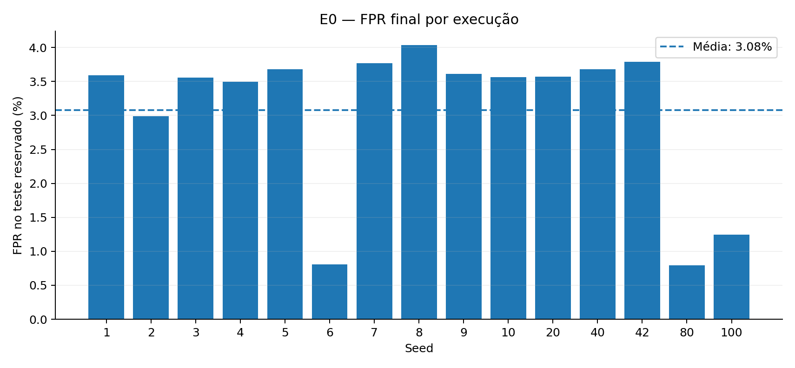
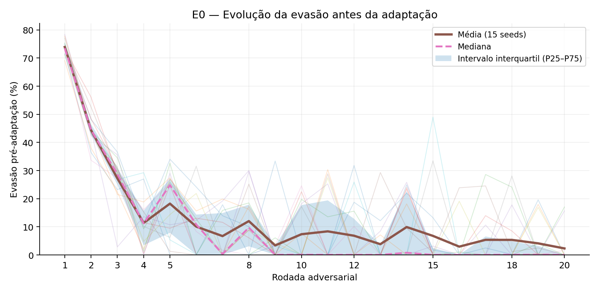
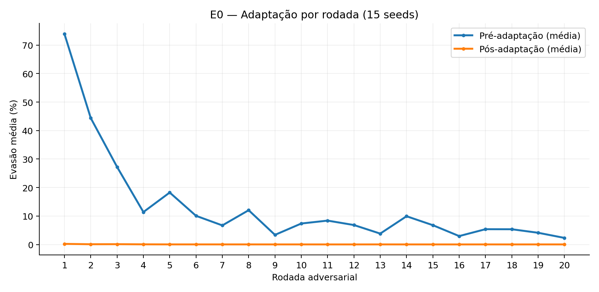
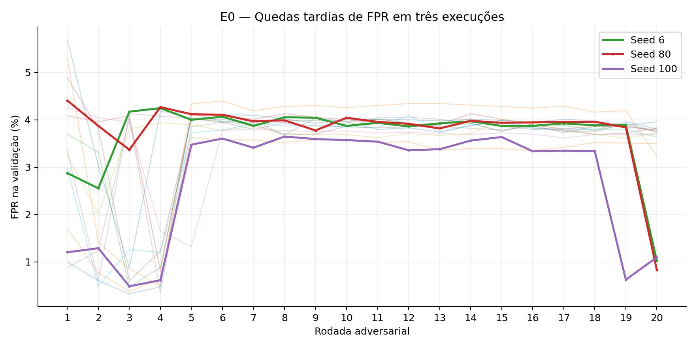
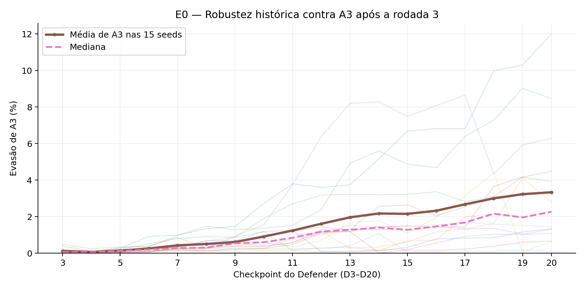
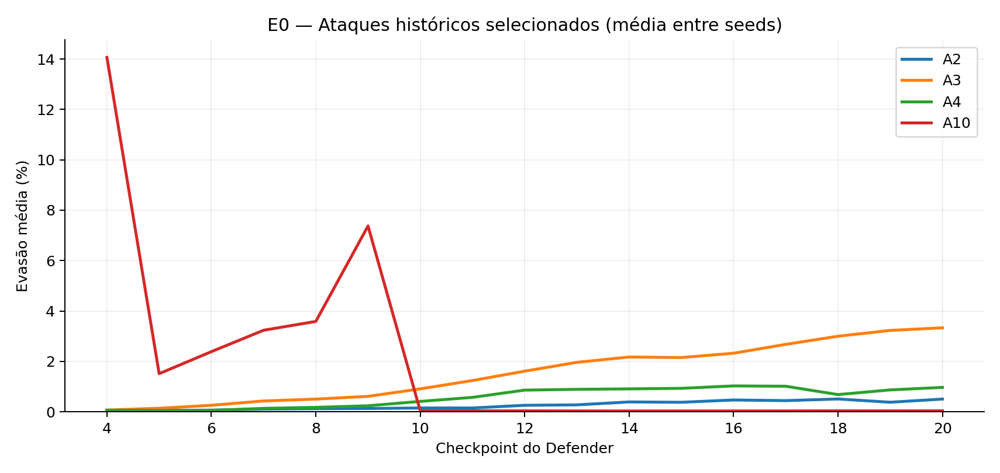

# E0 — Baseline multi-seed

## Estado

**Concluído (análise descritiva).** Coleta: 20 de outubro de 2026; 15 execuções independentes (seeds 1–10, 20, 40, 42, 80 e 100); 300 rodadas adversariais. O documento substitui a etapa inicial de planejamento (seeds 42, 43 e 44) pelos experimentos efetivamente executados.

## 1. Pergunta científica

> O comportamento atual da ADArena é estável quando o mesmo experimento é repetido com diferentes seeds?

## 2. Hipótese

> Mantendo dataset, arquitetura e hiperparâmetros constantes, seeds diferentes devem produzir variação quantitativa nas métricas, mas preservar o comportamento qualitativo de adaptação do Defender.

**Critério interpretativo**: observar capacidade inicial de evasão, redução da evasão após adaptação, variabilidade entre seeds e desempenho no teste reservado. Não é exigida convergência monotônica. O E0 não pretende prever o resultado a partir do valor numérico da seed.

## 3. Objetivo

Estabelecer a baseline multi-seed da linha ADArena v2.7; caracterizar a evolução temporal da evasão e os resultados finais, quantificar a variabilidade e identificar limitações que possam orientar E1–E3 sem modificar os modelos neste experimento.

## 4. Metodologia e variáveis

- **Variável alterada:** seed (1–10, 20, 40, 42, 80, 100). As partições treino/validação/teste e a inicialização dependem da seed; portanto, o E0 mede a variabilidade do **pipeline completo**, e não somente da inicialização.
- **Controles verificados nos `config_execucao.json`:** demais campos idênticos entre as 15 execuções após excluir identificador de run, data de criação e seed. Todos no modo `TRAIN`, com o mesmo dataset, componentes e hiperparâmetros.
- **Dataset:** CIC-IDS2017, `data/DDoS-Friday-no-metadata.parquet`, 221.264 amostras, 77 features; benignas 93.250 e DDoS 128.014. Split por execução: treino 154.884, validação 22.127 e teste 44.253, sem interseção reportada.
- **Modelos e protocolo:** `adarena.perturbation_attacker`, `adarena.binary_mlp_defender`, `adarena.adversarial_training`; threshold 0,5; epsilon 0,3; pré-treino de 5 epochs; 20 rodadas de 3 epochs; 5.000 amostras adversariais de validação por rodada.
- **Coleta:** 15 ZIPs contendo `summary.json`, `historico_treino.json`, `matriz_checkpoints.json`, configuração, gráficos, métricas e checkpoints. O pipeline foi executado localmente pelo pesquisador; esta análise reproduz cálculos a partir dos artefatos exportados, sem retreinar modelos.
- **Estatística:** médias, desvios padrões amostrais (n=15, `ddof=1`), medianas, mínimos e máximos. Para curvas por rodada, são calculados valores agregados entre 15 runs na mesma rodada. **Não tratar as 300 rodadas como amostras independentes** para inferência estatística.
- **Ganho de adaptação:** `evasao_pre - evasao_pos`, em pontos percentuais; taxas de evasão são frações antes de converter para %. **MCC** calculado a partir da matriz de confusão final (`TN`, `FP`, `FN`, `TP`) — não foi uma métrica exportada diretamente no `summary.json`.

## 5. Execuções e desempenho final

| Seed | Run ID | F1 teste | FPR teste | Recall teste | MCC teste | Evasão média histórica × D20 | Pior ataque histórico × D20 |
|---:|---|---:|---:|---:|---:|---:|---|
| 1 | `run_20261020_095017_seed1` | 98,69% | 3,59% | 99,97% | 0,969 | 0,81% | A3 (11,98%) |
| 2 | `run_20261020_095544_seed2` | 98,90% | 2,99% | 99,96% | 0,974 | 0,24% | A3 (2,78%) |
| 3 | `run_20261020_100103_seed3` | 98,71% | 3,55% | 99,97% | 0,969 | 0,70% | A3 (8,46%) |
| 4 | `run_20261020_100504_seed4` | 98,72% | 3,50% | 99,95% | 0,969 | 0,08% | A3 (0,66%) |
| 5 | `run_20261020_100638_seed5` | 98,66% | 3,68% | 99,97% | 0,968 | 0,07% | A3 (1,08%) |
| 6 | `run_20261020_100812_seed6` | 99,67% | 0,80% | 99,92% | 0,992 | 0,23% | A3 (3,30%) |
| 7 | `run_20261020_100948_seed7` | 98,62% | 3,77% | 99,96% | 0,967 | 0,10% | A3 (1,44%) |
| 8 | `run_20261020_101108_seed8` | 98,53% | 4,04% | 99,95% | 0,965 | 0,58% | A3 (6,28%) |
| 9 | `run_20261020_101215_seed9` | 98,68% | 3,61% | 99,95% | 0,969 | 0,05% | A3 (0,62%) |
| 10 | `run_20261020_101319_seed10` | 98,69% | 3,57% | 99,95% | 0,969 | 0,07% | A2 (0,10%) |
| 20 | `run_20261020_101426_seed20` | 98,68% | 3,57% | 99,94% | 0,969 | 0,10% | A3 (1,34%) |
| 40 | `run_20261020_101548_seed40` | 98,64% | 3,68% | 99,93% | 0,968 | 0,31% | A3 (2,26%) |
| 42 | `run_20261020_093811_seed42` | 98,61% | 3,79% | 99,95% | 0,967 | 0,24% | A3 (3,92%) |
| 80 | `run_20261020_101719_seed80` | 99,68% | 0,79% | 99,94% | 0,992 | 0,34% | A3 (4,48%) |
| 100 | `run_20261020_101856_seed100` | 99,53% | 1,24% | 99,97% | 0,989 | 0,38% | A2 (4,60%) |

### 5.1 Síntese quantitativa

| Métrica | Média ± DP | Mediana | Mínimo–máximo |
|---|---:|---:|---:|
| F1 no teste | 98,87% ± 0,40 pp | 98,69% | 98,53%–99,68% |
| Recall no teste | 99,95% ± 0,02 pp | 99,95% | 99,92%–99,97% |
| FPR no teste | 3,08% ± 1,13 pp | 3,57% | 0,79%–4,04% |
| MCC no teste | 0,973 ± 0,010 | 0,969 | 0,965–0,992 |
| ROC-AUC no teste | 0,99974 ± 0,00010 | 0,99972 | 0,99949–0,99993 |
| Evasão média histórica contra D20 | 0,29% ± 0,24 pp | 0,24% | 0,05%–0,81% |
| Maior evasão histórica contra D20 | 3,55% ± 3,29 pp | 2,78% | 0,10%–11,98% |

**Leitura:** desempenho convencional geralmente elevado, mas FPR e evasão histórica apresentam dispersão mais relevante que recall. Valores de FPR representam **teste reservado**, enquanto as séries temporais de FPR (a seguir) representam **validação**; essas medidas não devem ser misturadas numa mesma curva.



## 6. Evolução da evasão ao longo das rodadas





| Rodada | Pré: média ± DP (%) | Pré: mediana (%) | Pós: média (%) | Ganho: média (pp) |
|---:|---:|---:|---:|---:|
| 1 | 73,92 ± 2,49 | 73,50 | 0,23 | 73,70 |
| 2 | 44,38 ± 5,73 | 44,42 | 0,10 | 44,28 |
| 3 | 27,23 ± 8,10 | 28,72 | 0,12 | 27,11 |
| 4 | 11,40 ± 9,05 | 11,22 | 0,06 | 11,33 |
| 5 | 18,25 ± 11,84 | 24,82 | 0,04 | 18,21 |
| 6 | 10,07 ± 10,19 | 10,82 | 0,04 | 10,03 |
| 7 | 6,71 ± 8,41 | 0,36 | 0,04 | 6,67 |
| 8 | 12,04 ± 10,47 | 9,72 | 0,04 | 12,00 |
| 9 | 3,39 ± 8,54 | 0,06 | 0,03 | 3,35 |
| 10 | 7,37 ± 9,90 | 0,10 | 0,04 | 7,34 |
| 11 | 8,39 ± 12,74 | 0,06 | 0,03 | 8,36 |
| 12 | 6,84 ± 10,95 | 0,06 | 0,03 | 6,81 |
| 13 | 3,83 ± 8,06 | 0,06 | 0,04 | 3,79 |
| 14 | 9,93 ± 11,46 | 0,78 | 0,03 | 9,89 |
| 15 | 6,78 ± 14,69 | 0,06 | 0,03 | 6,75 |
| 16 | 2,96 ± 7,58 | 0,04 | 0,03 | 2,93 |
| 17 | 5,38 ± 9,64 | 0,06 | 0,04 | 5,34 |
| 18 | 5,36 ± 9,75 | 0,10 | 0,03 | 5,33 |
| 19 | 4,13 ± 7,37 | 0,08 | 0,04 | 4,09 |
| 20 | 2,32 ± 5,72 | 0,04 | 0,04 | 2,29 |

- **Primeira rodada:** evasão pré-adaptação média 73,92% (DP 2,49 pp). O atacante encontrou evasão em todas as 15 seeds e a adaptação reduziu a evasão significativamente na rodada inicial.
- **Quarta rodada:** evasão pré-adaptação média 11,40%; **vigésima:** 2,32% (mediana 0,04%). A média final é influenciada por picos nas seeds 42 e 100. Isso mostra declínio agregado entre início e fim, **não** uma queda contínua.
- **Oscilações persistentes:** foram observadas 40 rodadas com evasão pré-adaptação ≥10% entre as rodadas 10–20, distribuídas por 15 seeds. Há recuperação temporária da capacidade de evasão pelo Attacker mesmo após períodos com valores próximos de zero.
- **Resposta imediata do Defender:** evasão pós-adaptação média de 0,054% nas 300 comparações; 299/300 rodadas (99,67%) terminaram com evasão pós-adaptação abaixo de 1%. O único valor ≥1% ocorreu na seed 8, rodada 1 (1,26%).
- **Ataques com evasão pré ≥5%:** 139/140 ficaram abaixo de 1% após adaptação, reforçando que o padrão de adaptação aparece principalmente quando existe uma evasão material a reduzir.
- **Ganho médio por rodada e seed, agregado descritivamente:** 13,48 pp. Em rodadas com evasão pré já muito próxima de zero, o ganho se aproxima de zero ou pode ser levemente negativo; isso não invalida o efeito observado nos picos.

**Interpretação temporal:** a curva sugere redução acentuada nas rodadas iniciais, seguida de oscilações/episódios de evasão, sem lei de crescimento determinística ou convergência monotônica. É possível descrever o desempenho típico ao longo dessas 20 rodadas por média, mediana e dispersão empíricas; não é adequado extrapolar mecanicamente para mais rodadas ou prever a partir do inteiro da seed.

## 7. Diferenças no FPR: efeito persistente ou tardio?

Na avaliação final do teste reservado, as seeds 6, 80 e 100 apresentaram FPR de 0,80%, 0,79% e 1,24%, respectivamente. As outras 12 ficaram entre 2,99% e 4,04%.

Uma inspeção das séries de validação muda a interpretação: na rodada 18, o FPR médio entre as 15 execuções era 3,78% ± 0,20 pp. As três seeds destacadas **ainda tinham valores próximos aos demais** nessa rodada.

| Seed | FPR validação r18 | FPR validação r19 | FPR validação r20 | FPR teste final |
|---:|---:|---:|---:|---:|
| 6 | 3,88% | 3,89% | 1,02% | 0,80% |
| 80 | 3,96% | 3,84% | 0,83% | 0,79% |
| 100 | 3,34% | 0,62% | 1,09% | 1,24% |



**Resultado observado:** a melhora aparece no último checkpoint (seeds 6 e 80) e nas duas últimas rodadas (seed 100), sem perda expressiva de recall nessas transições. **Interpretação:** esses resultados não demonstram a existência de um regime de baixo FPR persistentemente estável; são pontos finais favoráveis de trajetórias que anteriormente apresentavam FPR semelhante ao das outras seeds. Não é possível inferir só pelas curvas se a causa é composição das partições, dinâmica de atualização, oscilações do classificador ou outro fator. Não selecionar seeds a posteriori como se fossem arquiteturas superiores.

## 8. Recorrência do A3 e retenção de robustez histórica

A avaliação cruzada compara `A1..A20` contra `D0..D20` **dentro de cada execução**. O atacante A3 foi o pior caso contra D20 em **13/15 seeds**; A2 foi o pior nas outras 2.





Para o mesmo checkpoint de atacante A3, comparando as avaliações de cada matriz:

- Evasão de A3 contra D3: média **0,12%** entre seeds;
- Evasão de A3 contra D20: média **3,33%**, mediana 2,26%, máximo 11,98% (seed 1);
- A diferença A3×D20 − A3×D3 foi positiva em **14/15 seeds**, média **3,21 pp**. Na seed 10, houve pequena redução (-0,04 pp).

| Seed | Evasão A3×D3 | Evasão A3×D20 | Diferença |
|---:|---:|---:|---:|
| 1 | 0,06% | 11,98% | 11,92 pp |
| 2 | 0,04% | 2,78% | 2,74 pp |
| 3 | 0,48% | 8,46% | 7,98 pp |
| 4 | 0,04% | 0,66% | 0,62 pp |
| 5 | 0,08% | 1,08% | 1,00 pp |
| 6 | 0,20% | 3,30% | 3,10 pp |
| 7 | 0,16% | 1,44% | 1,28 pp |
| 8 | 0,06% | 6,28% | 6,22 pp |
| 9 | 0,02% | 0,62% | 0,60 pp |
| 10 | 0,12% | 0,08% | -0,04 pp |
| 20 | 0,02% | 1,34% | 1,32 pp |
| 40 | 0,06% | 2,26% | 2,20 pp |
| 42 | 0,04% | 3,92% | 3,88 pp |
| 80 | 0,38% | 4,48% | 4,10 pp |
| 100 | 0,02% | 1,30% | 1,28 pp |

**Resultado observado:** a capacidade de detectar o A3 não se manteve igualmente forte ao longo da sequência de checkpoints, apesar de o Defender apresentar evasão pós-adaptação muito baixa em rodadas individuais. **Hipótese interpretativa:** possível perda de robustez contra um ataque antigo durante o treinamento continuado, compatível com esquecimento parcial. **Não comprovado neste E0:** o mecanismo de esquecimento, causalidade específica ou desempenho perante atacantes de outras seeds. Isso justifica uma investigação direcionada em E1/E2, não uma modificação imediata do modelo.

## 9. Confronto com a hipótese

| Critério | Evidência dos artefatos | Julgamento |
|---|---|---|
| Attacker encontra evasão | Evasão pré inicial em todas as 15 seeds; média 73,92% | Sustentado |
| Defender adapta nas mesmas rodadas | 299/300 evasões pós abaixo de 1%; 139/140 quando pré ≥5% | Sustentado para adaptação imediata |
| Intensidade varia quantitativamente | FPR de 0,79%–4,04%; evasão histórica máxima de 0,10%–11,98% | Sustentado; variação relevante |
| Convergência monotônica | Picos de evasão durante todo o ciclo | Não observada nem exigida |
| Robustez a ataques históricos preservada | A3×D20 > A3×D3 em 14/15 | Não sustentado como estabilidade temporal forte |

**Síntese:** a hipótese é **parcialmente sustentada**. O comportamento qualitativo central — surgimento de evasão e adaptação imediata — foi reproduzido em todas as seeds. Entretanto, a consistência da resposta imediata não equivale a estabilidade temporal plena: o FPR final depende fortemente do checkpoint e algumas resistências históricas enfraquecem com o treinamento.

## 10. Limitações e validade

1. **Split variável:** seed altera partições e inicialização; impossível atribuir toda a dispersão à inicialização isoladamente. Diferentes composições de teste restringem comparações causais.
2. **Seleção intencional de seeds:** não são uma amostra formalmente aleatória do espaço de seeds; estatísticas são descritivas para as 15 execuções, não garantias universais.
3. **Dependência temporal:** 20 rodadas de uma mesma seed compartilham estado e treino. Não usar 300 como n independente.
4. **Avaliação histórica intra-seed:** D20 contra Attackers históricos da própria trajetória, sem testes cross-seed ou ataques desconhecidos; generalização não foi examinada.
5. **Uma execução por seed:** não avalia determinismo ou reprodutibilidade bit a bit para seeds repetidas.
6. **Métricas e domínio:** apenas um dataset e família DDoS; alta performance em dataset de features não comprova eficácia sobre pacotes transmitidos ou plausibilidade física das perturbações.
7. **Análise pós-hoc:** picos A3 e baixo FPR de 6/80/100 foram identificados nos dados. Não interpretar suas comparações como testes confirmatórios sem pré-registro ou validação adicional.
8. **Horizonte fixo:** 20 rodadas; tendência empírica não estabelece taxa assintótica de crescimento nem garante projeção para períodos mais longos.

## 11. Conclusão e decisão

**Conclusão do E0:** a configuração atual da ADArena oferece uma baseline **adequada para estudar adaptação imediata em condições controladas**, com resposta forte do Defender aos ataques gerados durante as mesmas rodadas e com desempenho convencional alto. Porém, sua estabilidade deve ser descrita como **parcial**, não total: o FPR exibe alterações tardias e a robustez frente ao checkpoint histórico A3 pode diminuir em defensores posteriores.

**Decisão:** concluir E0 sem novo treinamento complementar obrigatório e usar a distribuição empírica (média, DP, mediana, mínimo/máximo por seed e curvas por rodada) como referência nas comparações futuras. Ao comparar melhorias, manter as mesmas sementes, documentar o split, reportar métricas convencionais **e** robustez histórica, e evitar selecionar apenas o checkpoint com melhor FPR sem critério prévio de seleção.

## 12. Próximos passos derivados

- **E1 (adaptação):** investigar retenção da resposta a Attackers históricos, especialmente A3 ao longo de D3–D20; comparar adaptação imediata com resistência acumulada.
- **E2 (generalização):** avaliar Attackers ou checkpoints separados da adaptação quando formalmente não observados pelo Defender.
- **E3 (cross-seed):** estudar transferência entre treinamentos independentes com seeds distintas.
- **Complemento opcional, não pré-requisito do E0:** fixar as partições e variar só a aleatoriedade dos modelos para estudar separadamente a variação do FPR; repetir alguma seed para testar reprodutibilidade; avaliar seleção de checkpoint por validação com regra definida antes de consultar teste.

## 13. Artefatos reproduzíveis

Na pasta [`e0_assets`](e0_assets/):

- `resumo_por_seed.csv` — uma linha por seed (15);
- `metricas_por_rodada.csv` — 20 rodadas × 15 seeds (300);
- `evasao_historica_d20.csv` — 20 ataques × 15 seeds (300);
- `matriz_checkpoints_longa.csv` — 20 ataques × 21 Defenders × 15 seeds (6.300);
- `01_*.png` a `06_*.png` — visualizações;
- `scripts/analisar_e0.py` (na raiz do pacote) — reconstrução dos dados e relatório a partir dos ZIPs, sem carregar os checkpoints `.pth`.

**Para reproduzir a análise com os ZIPs em diretório próprio:**

```bash
python scripts/analisar_e0.py --source 'models/e0/exports/run_*seed*.zip' --out .
```

Os arquivos `.zip` de execução originais não estão incluídos neste pacote de relatório devido ao tamanho; devem ser preservados separadamente como dados brutos do experimento.
