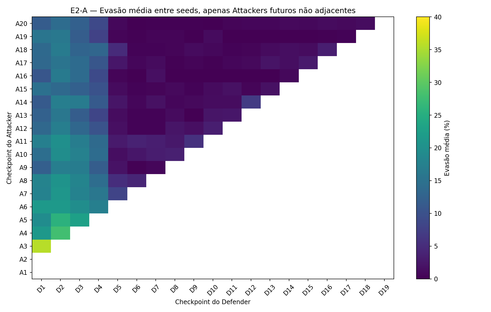
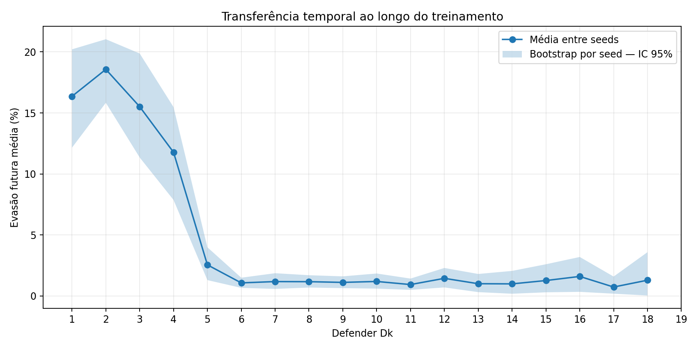
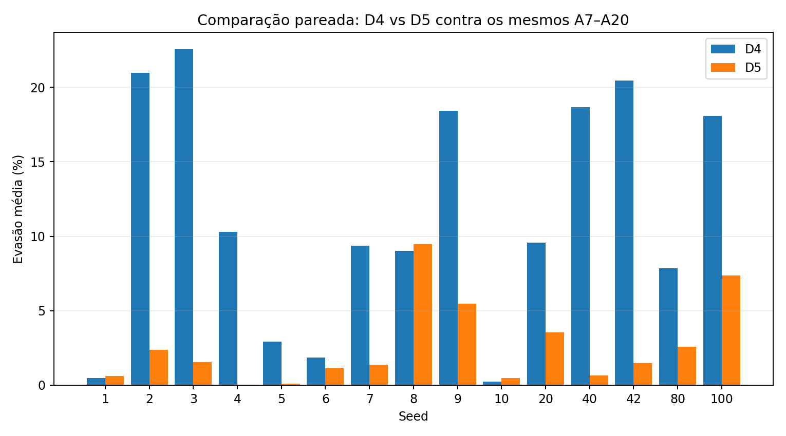
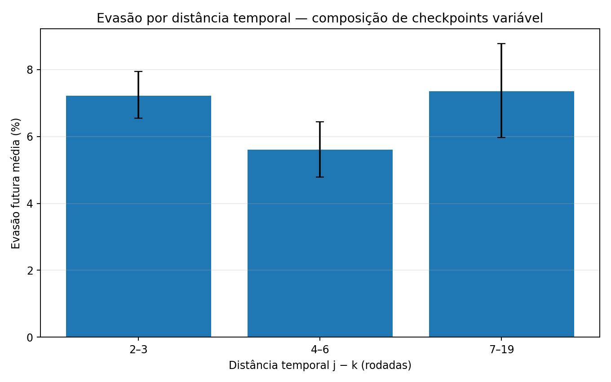
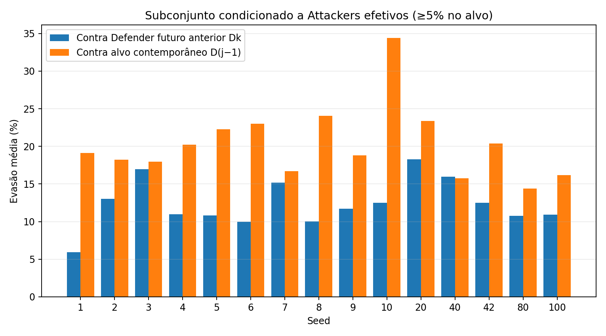
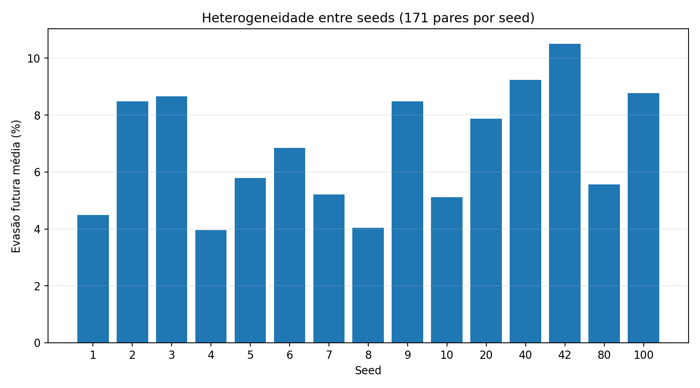
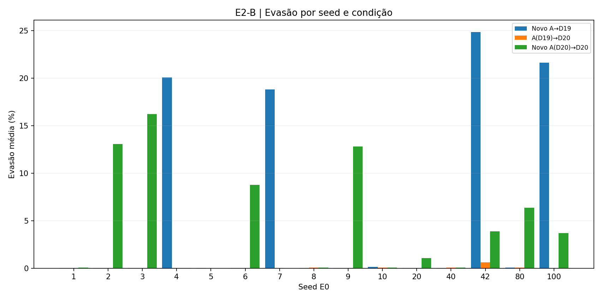
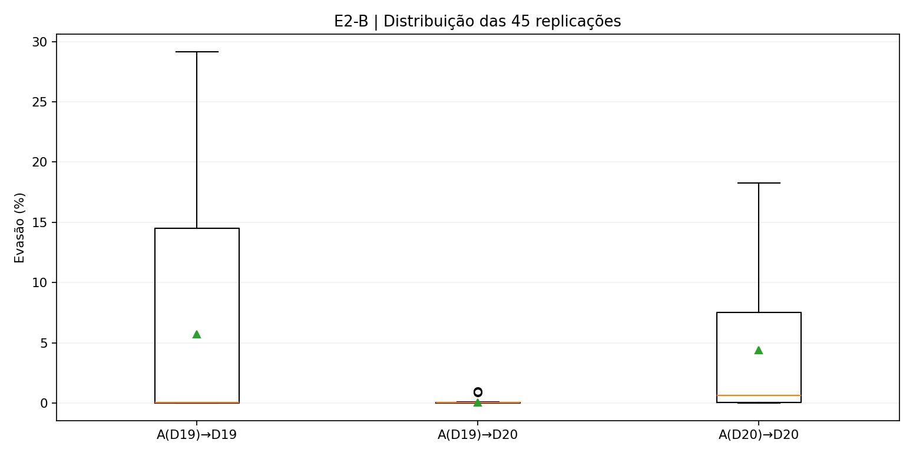
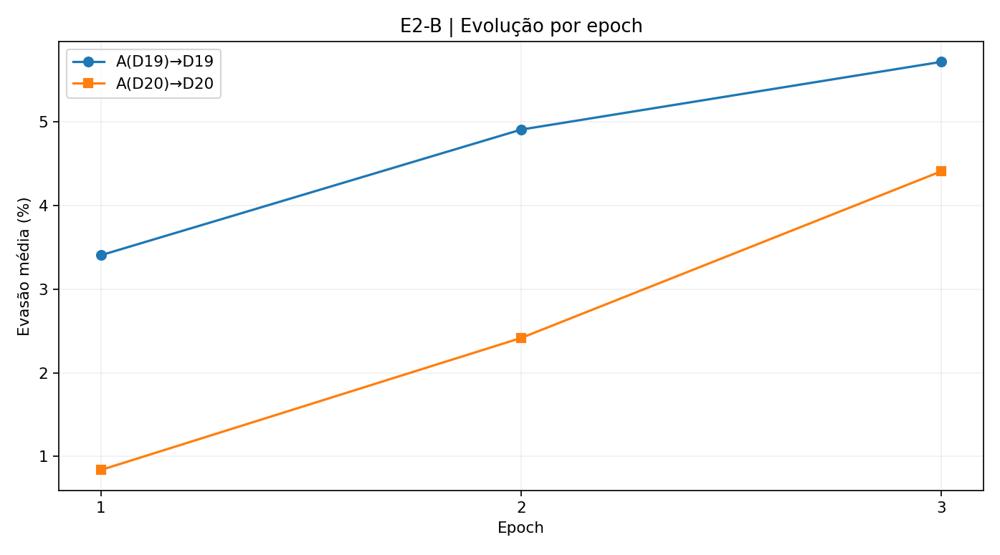

# E2 — Generalização temporal para Attackers não observados diretamente

**Estado (03/11/2026): E2 concluído.** E2-A finalizado com análise retrospectiva das 15 seeds do E0; E2-B finalizado após dois pilotos de inicialização aleatória, revisão metodológica para inicialização histórica em A20 e **45 replicações controladas** (15 seeds × 3 replicações), com D19 e D20 congelados. As conclusões e limitações encontram-se nas seções 7 e 8.

## 1. Pergunta científica

> Um Defender adaptado até a rodada `k` mantém baixa taxa de evasão diante de checkpoints do Attacker de rodadas posteriores, com os quais não foi diretamente treinado?

O E2 investiga **transferência temporal dentro de uma mesma trajetória de treinamento**. Não equivale a generalização entre seeds (E3), entre famílias de ataques ou a robustez a tráfego real.

## 2. Hipóteses

- **H1 — transferência temporal:** parte da robustez adquirida se mantém contra checkpoints posteriores não apresentados diretamente ao Defender.
- **H2 — dependência do estágio:** o comportamento varia conforme o estágio de treinamento e, possivelmente, a distância entre os checkpoints.
- **H3 — efetividade do Attacker:** evasão futura baixa não basta para demonstrar robustez se o próprio Attacker também não consegue evadir seu Defender contemporâneo.

## 3. Desenho experimental e metodologia

### Fonte e integridade

- Matrizes `matriz_checkpoints.json` dos **15 ZIPs originais do E0**, seeds `1–10, 20, 40, 42, 80 e 100`.
- Cada matriz: Attackers `A1..A20` × Defenders `D0..D20` (20 × 21).
- A validação automática conferiu dimensão, ordenação de índices, intervalo dos valores (frações de 0 a 1) e igualdade entre `E(A_j,D_(j−1))` da matriz e o histórico pré-adaptação do E0.
- Foram utilizados os dados salvos, **sem executar treinamento adicional nem reavaliar redes neurais**.

### Comparações

Para cada seed e cada par `(j,k)`:

- **Conjunto amplo:** `1 ≤ k ≤ 19`, `j > k`: 190 pares/seed, **2.850** no total.
- **Conjunto principal não adjacente:** `1 ≤ k ≤ 18`, `j ≥ k+2`: 171 pares/seed, **2.565** no total. O conjunto exclui as 19 comparações adjacentes por seed, que já correspondem à avaliação pré-adaptação do E0.
- **Critério exploratório de efetividade:** selecionar pares cujo `A_j` obteve evasão `≥ 5%` contra `D_(j−1)`; o corte é descritivo e não um padrão universal de qualidade.
- **D0** não participa do conjunto principal, pois ainda não recebeu adaptação adversarial. **D19** tem apenas `A20` como futuro adjacente, portanto nenhum par não adjacente; **D20** não possui Attacker posterior no E0.

A evasão é calculada em **porcentagem**; diferenças entre taxas são indicadas em **pontos percentuais (pp)**.

### Unidades e incerteza

As 15 **seeds** são as unidades de agregação para médias gerais e intervalos bootstrap (5.000 reamostragens de seeds completas, semente fixa 2026). Os 2.565 pares são dependentes dentro de cada treinamento e **não são observações independentes**. As seeds foram escolhidas intencionalmente, e os intervalos são resumos de incerteza da campanha, não garantias populacionais.

## 4. Resultados

### 4.1 Visão geral

| Indicador (pares não adjacentes) | Resultado |
|---|---:|
| Pares analisados | **2.565** (171 por seed) |
| Evasão média futura | **6,87%** |
| IC bootstrap de 95% para média por seed | **5,83%–7,93%** |
| Mediana de evasão por par | **0,10%** |
| Pares com evasão abaixo de 1% | **58,13%** |
| Pares com evasão de pelo menos 5% | **33,80%** |

A média consideravelmente superior à mediana mostra uma distribuição assimétrica, com numerosos pares próximos de zero e uma parcela significativa de evasões elevadas. A média geral sozinha não descreve o comportamento em cada estágio.



### 4.2 O estágio do Defender é decisivo

| Defender | Evasão média contra Attackers futuros não adjacentes |
|---|---:|
| D1 | 16,36% |
| D2 | 18,57% |
| D3 | 15,51% |
| D4 | 11,77% |
| D5 | 2,55% |
| D6 | 1,07% |
| D10 | 1,19% |
| D15 | 1,26% |

Para os pares disponíveis, `D1–D4` tiveram média de **15,68%** e `D5–D18` tiveram **1,33%**. Essas médias agrupadas possuem diferentes quantidades e identidades de Attackers; por isso, não constituem, por si só, uma comparação controlada de estágios.



**Comparação pareada D4–D5:** ao avaliar ambos contra o **mesmo conjunto `A7..A20`** dentro de cada seed, a evasão caiu em média **8,83 pp** de D4 para D5 (IC bootstrap por seed 95%: **5,23–12,73 pp**), com redução em **12 das 15 seeds**. A comparação pareada elimina o problema da mudança de Attackers entre D4 e D5, mas ainda é observacional ao longo de uma mesma trajetória: não demonstra que uma rodada específica seja causalmente responsável por toda a diferença.



### 4.3 Distância temporal

| Diferença entre checkpoints (`j−k`) | Evasão média |
|---|---:|
| 2–3 rodadas | 7,22% |
| 4–6 rodadas | 5,61% |
| 7–19 rodadas | 7,35% |

Não há aumento monotônico simples da evasão com a distância temporal. As faixas reúnem estágios do Defender e Attackers diferentes; portanto, a comparação é **descritiva**, não uma estimativa isolada do efeito de envelhecimento da defesa.



### 4.4 Efetividade dos Attackers

**Apenas 768/2.565 pares (29,94%)** envolvem Attackers com evasão de pelo menos 5% contra seu próprio Defender contemporâneo (`D_(j−1)`). Nesse subconjunto:

- Evasão média contra o Defender anterior avaliado no E2: **11,79%**.
- Evasão média contra seu Defender contemporâneo: **19,81%**.
- **33,20%** das avaliações contra Defenders anteriores ainda ficaram abaixo de 1% de evasão.

Ao restringir a análise a Attackers efetivos, a evasão aumenta substancialmente. Isso impede interpretar os muitos zeros da matriz como prova isolada de generalização defensiva. O filtro também altera a composição dos exemplos e deve ser apresentado como **análise de sensibilidade descritiva**, não substituto da análise principal.

Nos pares com Attacker efetivo, `D1–D4` registraram evasão média de **19,96%**, e `D5–D18` de **4,39%** (com os mesmos cuidados sobre composição desigual dos pares).



### 4.5 Variabilidade entre seeds

A evasão média futura variou de **3,95% (seed 4)** a **10,50% (seed 42)**, reforçando que a conclusão deve considerar a variabilidade das execuções completas.



## 5. Confronto com as hipóteses

| Hipótese | Interpretação dos resultados |
|---|---|
| **H1** | **Parcialmente sustentada:** Defenders de estágios posteriores demonstram baixas taxas de evasão contra muitos Attackers futuros da mesma trajetória; D1–D4 permanecem consideravelmente vulneráveis. |
| **H2** | **Sustentada quanto à dependência do estágio:** o contraste D4–D5 persiste no confronto pareado com Attackers idênticos. **Não foi observado padrão monotônico claro da distância** entre checkpoints. |
| **H3** | **Confirmada como limitação interpretativa importante:** a maioria dos pares não envolve Attackers efetivos pelo limiar escolhido, e a evasão futura do subconjunto efetivo é maior. |

### Conclusão do E2-A

**A generalização temporal observada é heterogênea e dependente do estágio do Defender.** O comportamento melhora após as primeiras rodadas, mas as taxas agregadas baixas não podem ser tomadas como prova ampla de robustez, pois muitos Attackers futuros não demonstram efetividade relevante nem no cenário contemporâneo. A inferência se limita à campanha retrospectiva e à mesma trajetória de treinamento.

## 6. Limitações metodológicas

1. **Dependência histórica:** `A_j` foi treinado contra a linhagem dos Defenders da mesma execução; não é um Attacker independente, mesmo sendo posterior a `D_k`.
2. **Dataset e split:** seeds alteram também os splits do CIC-IDS2017, impedindo isolar efeitos da inicialização.
3. **Dados de validação reutilizados:** matrizes foram produzidas com avaliação offline fixa na campanha do E0; não houve teste externo independente.
4. **Dados em espaço de features:** evasão não comprova viabilidade protocolar nem desempenho em tráfego real.
5. **Composição temporal desigual:** Defenders tardios possuem menos Attackers futuros; comparações por distância e checkpoints requerem cuidado.
6. **Efetividade condicionada:** o corte de 5% é arbitrário e a seleção pode favorecer subconjuntos específicos de Attackers/rodadas.
7. **D20 não foi testado prospectivamente pela matriz:** ela não contém A21 ou posterior; os pilotos posteriores do E2-B são análises separadas.
8. **Efetividade dos novos geradores:** evasão baixa contra D20 não demonstra robustez quando o Attacker também falha contra o alvo usado no treinamento.
9. **Inicialização histórica e dependência:** um futuro Attacker iniciado a partir de A20 herda informações da mesma trajetória; sua transferência não equivale à de um modelo independente ou de outra seed.

## 7. E2-B — Avaliação complementar do Defender final (concluído)

### 7.1 Pergunta e procedimento

O E2-B pergunta se o Defender final **D20** resiste a Attackers produzidos após a rodada 20, diferenciando **transferência temporal** de **ataque adaptativo direcionado**. D19 e D20 permanecem congelados durante os novos treinamentos.

- **Transferência (D19 → D20):** novo Attacker otimizado contra D19, avaliado contra D19 e contra D20. O desempenho em D19 é indispensável para julgar a efetividade da fonte.
- **Estresse adaptativo (D20 → D20):** outro Attacker otimizado diretamente contra D20, avaliado no próprio D20. Não é prova de transferência ou de generalização independente.
- **Referências:** tráfego DDoS sem perturbação, gerador aleatório não treinado e A20 histórico. Integridade histórica conferida por seed com os valores de A20×D19/D20.

Todos os novos Attackers usam **pesos iniciais de A20 histórico** e **otimizador Adam novo**, pois o E0 não preservou o estado anterior do otimizador. Cada braço usa 3 epochs, 89.609 amostras de treino DDoS, batch 512, `epsilon=0,3`, `noise_dim=32` e 5.000 amostras DDoS fixas de validação para avaliação. O conjunto de teste reservado não foi utilizado. O valor `--init-attacker a20` é obrigatório na campanha revisada.

**Cronologia da mudança:** dois pilotos com inicialização aleatória na seed 42 (5.000 e 89.609 amostras) produziram evasão quase nula contra o próprio alvo. Por isso a metodologia foi revisada para continuar a partir dos pesos A20. Três pilotos com seed original 42 (attacker seeds 1042, 1043 e 1044) mostraram que a nova abordagem podia obter ataques efetivos; em seguida, foram executadas **42 replicações adicionais** para as outras 14 seeds, totalizando **45**.

### 7.2 Integridade e unidades estatísticas

O arquivo `campanha.zip` possui 42 execuções, com três replicações para cada uma das seeds 1–10, 20, 40, 80 e 100. As três replicações da seed 42 foram adicionadas a partir dos ZIPs anteriores. **As 45 execuções foram verificadas:** nenhuma combinação seed/replicação ausente ou duplicada; arquivos JSON e CSV disponíveis; checksums históricos D19/D20 e parâmetros constantes dentro de cada seed; integridade ZIP; números de epochs e tamanhos dos dados esperados; resultados finais iguais ao valor da epoch 3.

A unidade principal para agregar incerteza é a **seed do E0 (n=15)**. As três replicações de Attacker para uma mesma seed são dependentes, pois compartilham D19/D20, A20 histórico e split. Os intervalos de 95% abaixo foram calculados por **bootstrap de seeds inteiras**, com 20.000 reamostragens, semente fixa 2026. São intervalos exploratórios para esta campanha selecionada, não garantias populacionais.

### 7.3 Resultados gerais da campanha

| Condição (evasão na validação) | Média | Mediana | IC bootstrap 95% da média |
|---|---:|---:|---:|
| Novo A(D19) → D19 (eficácia no alvo) | **5,72%** | 0,04% | 1,36–10,76% |
| Novo A(D19) → D20 (transferência) | **0,077%** | 0,04% | 0,029–0,161% |
| Novo A(D20) → D20 (estresse adaptativo) | **4,41%** | 0,66% | 1,84–7,35% |

A diferença média pareada entre ataques **direcionados a D20** e **transferidos de D19 para D20** foi de **4,33 pontos percentuais (pp)** (IC bootstrap de 95%: **1,76–7,29 pp**). Não constitui uma medida de ganho do treinamento da defesa; os Attackers foram otimizados para alvos distintos, e a efetividade contra o alvo de treino variou entre seeds.





### 7.4 Efetividade dos Attackers e interpretação condicionada

- O Attacker treinado contra **D19** atingiu evasão **≥5% no próprio D19 em 12/45** replicações, pertencentes a apenas **4/15 seeds** (4, 7, 42, 100). Nas demais, a eficácia na fonte foi insuficiente para uma avaliação forte de transferência.
- Nas **12 replicações efetivas contra D19**, a evasão média no próprio D19 foi **21,34%**, mas a transferência média para D20 foi **0,177%**. Nenhuma das 45 transferências alcançou 1% de evasão contra D20; máximo observado **0,96%**.
- O Attacker **direcionado a D20** alcançou evasão ≥5% em **16/45 replicações**, distribuídas em **6/15 seeds** (2, 3, 6, 9, 42, 80). Em 22/45 atingiu pelo menos 1%; a evasão máxima foi **18,24%** (seed original 3).
- Nas outras seeds, a evasão direta permaneceu muito baixa. Portanto, D20 demonstra **resistência relativa às tentativas examinadas**, e não imunidade contra otimização adversarial.

A concentração de valores baixos torna a **mediana** e a frequência de Attackers efetivos tão importantes quanto a média. O limiar de 5% é uma escolha exploratória descritiva, não um critério universal de sucesso.

### 7.5 Resumo por seed original

| Seed | A(D19)→D19 | A(D19)→D20 | A(D20)→D20 |
|---:|---:|---:|---:|
| 1 | 0.02% | 0.04% | 0.06% |
| 2 | 0.04% | 0.03% | 13.06% |
| 3 | 0.02% | 0.02% | 16.22% |
| 4 | 20.06% | 0.04% | 0.04% |
| 5 | 0.02% | 0.00% | 0.00% |
| 6 | 0.02% | 0.03% | 8.78% |
| 7 | 18.83% | 0.02% | 0.00% |
| 8 | 0.03% | 0.06% | 0.06% |
| 9 | 0.02% | 0.01% | 12.81% |
| 10 | 0.12% | 0.08% | 0.08% |
| 20 | 0.04% | 0.04% | 1.06% |
| 40 | 0.04% | 0.06% | 0.08% |
| 42 | 24.85% | 0.63% | 3.87% |
| 80 | 0.06% | 0.07% | 6.35% |
| 100 | 21.63% | 0.02% | 3.69% |

Cada linha é a **média de três replicações** naquela seed original. Por exemplo, na seed 42, o novo Attacker foi efetivo contra D19 (20,24%, 29,16%, 25,16%), mas transferiu pouco para D20 (0,90%, 0,02%, 0,96%). Em outras sementes, como 2, 3 e 9, ocorreram ataques diretamente adaptados a D20 com evasão superior a 10%, embora o braço de D19 não tenha sido eficaz no próprio alvo.

### 7.6 Dinâmica do treinamento do novo Attacker

A evasão média contra **D19** nos checkpoints das epochs 1, 2 e 3 foi respectivamente **3,41%, 4,91% e 5,72%**. Para o braço direcionado a **D20**, foi **0,84%, 2,42% e 4,41%**. Essa tendência das médias não significa crescimento monotônico em todas as replicações e não demonstra convergência.



### 7.7 Confronto com as hipóteses e limitações

**H1 (transferência temporal): parcialmente sustentada.** A evasão transferida para D20 foi baixa inclusive quando o Attacker era efetivo contra D19. Porém, em 33 das 45 replicações, não houve eficácia relevante contra D19, impedindo interpretar tais zeros como demonstrações independentes de generalização.

**H2 (dependência do estágio): sustentada descritivamente pelo E2-A**, com contrastes significativos de estágio na mesma linhagem. O E2-B complementa essa observação ao mostrar diferenças entre D19 e D20, mas não isola o efeito causal da rodada 20.

**H3 (efetividade como pré-requisito): corroborada.** O sucesso no próprio alvo variou muito entre seeds; ignorá-lo produziria conclusões superestimadas de robustez. Além disso, a evasão adaptativa contra D20 foi substancial em um subconjunto de seeds.

Limitações específicas do E2-B:

1. **Não independência histórica:** A20 pertence à mesma trajetória da adaptação de D20. A continuidade dos seus pesos não gera Attackers independentes nem uma família de ataque inédita.
2. **Estado do otimizador:** Adam foi reinicializado; o procedimento não equivale a retomar exatamente a trajetória do E0.
3. **Fonte inefetiva na maioria das replicações:** somente quatro seeds produziram ataques com evasão ≥5% em D19, restringindo a evidência de transferência.
4. **Avaliação reutilizada:** usa 5.000 amostras fixas de validação, examinadas repetidamente durante a pesquisa. O teste reservado permanece intacto; resultados não são confirmação independente externa.
5. **Escopo offline:** amostras são perturbações em features tabulares de DDoS, não garantia de tráfego de rede realizável.
6. **Variabilidade entre seeds:** as seeds de E0 também modificam split e trajetória de treinamento; comparações entre seeds não isolam inicialização.
7. **Orçamento específico:** três epochs e um gerador de perturbações específico não representam o conjunto de possíveis ataques adaptativos.

### 7.8 Critério de conclusão e próximos experimentos

**E2 encerrado no escopo planejado.** A evidência mais sólida é o contraste entre **baixa transferência temporal para D20** e **evasão não desprezível por otimização direta contra D20 em certas seeds**. Não se conclui que o Defender seja robusto a todo ataque prospectivo, apenas que resistiu às variantes transferidas examinadas, com ressalvas sobre a efetividade do Attacker fonte.

O E3 deve investigar generalização **entre linhagens independentes** e evitar interpretar pesos historicamente relacionados como ataques inéditos. Uma avaliação em teste externo, splits fixos e verificações de plausibilidade de tráfego exigiria desenho adicional fora deste E2.

### 7.9 Reprodutibilidade

O executor `docs/scientific/scripts/e2b_prospectivo.py` (versão com `--init-attacker a20`) permanece disponível, assim como seus testes. Os arquivos de análise em `e2_assets/data/e2b/` são:

- `replicacoes.csv`: 45 comparações, com baselines, resultados finais e valores por epoch.
- `resumo_por_seed.csv`: as 15 médias por seed original.
- `resumo_estatistico.json`: estatísticas, contagens e ICs bootstrap.

Para refazer as estatísticas e os três gráficos do E2-B, usar `docs/scientific/scripts/analisar_e2b.py` com `--campaign`, três opções `--pilot`, `--output` e `--figures` (ver instruções do pacote). **Os ZIPs originais dos checkpoints novos não estão duplicados no pacote de documentação**, para evitar inflar o repositório. Os pilotos iniciais permanecem em `e2_assets/data/pilotos/`.

## 8. Síntese conjunta e decisão de encerramento

**E2-A e E2-B concluídos dentro do escopo definido.** O E2-A indica transferência temporal heterogênea nos checkpoints da mesma linhagem: Defenders posteriores se saíram melhor contra vários Attackers futuros da matriz do E0, mas a efetividade de muitos desses Attackers era limitada. O E2-B acrescentou 45 replicações pós-treinamento (15 seeds de E0 × 3 inicializações de Attacker), usando D19/D20 congelados e pesos de A20 com Adam reinicializado.

O contraste do E2-B é importante: a **evasão transferida de D19 para D20 foi baixa**, ao passo que ataques **diretamente adaptados a D20** alcançaram evasão relevante em parte das seeds. Assim, resistência à transferência não equivale a resistência à otimização direcionada. Em muitas execuções, entretanto, o Attacker treinado contra D19 não se mostrou eficaz nem no próprio alvo; esses casos **não contam como demonstração forte** de generalização defensiva.

**Conclusão global:** as hipóteses de transferência temporal e dependência do estágio são **parcialmente sustentadas, com ressalvas**. Não há evidência de generalização irrestrita; o E2 se encerra como um experimento com resultados positivos condicionais, casos de falha e limitações explícitas. Investigações de transferência entre linhagens independentes pertencem ao E3.

## 9. Arquivos e reprodutibilidade

O script `docs/scientific/scripts/analisar_e2.py` lê os 15 diretórios originais ou ZIPs do E0, verifica consistência e escreve os resultados em `docs/scientific/e2/e2_assets/`.

```bash
uv run python docs/scientific/scripts/analisar_e2.py \
  --input models/e0/experiments \
  --output docs/scientific/e2/e2_assets
```

Os testes ficam em `h-attack/tests/adarena/test_e2_analysis.py`:

```bash
uv run pytest -q h-attack/tests/adarena/test_e2_analysis.py
```

A pasta `e2_assets/data/` contém os dados do E2-A (pares detalhados, resumos por seed, Defender e distância, comparação pareada D4–D5, contexto de métricas convencionais e `resumo_estatistico.json`), além de `e2_assets/data/e2b/` com os resultados das 45 replicações. A pasta `e2_assets/figures/` contém **nove gráficos**: seis do E2-A e três do E2-B.

**Nota:** o E2-A não executou qualquer treinamento novo e não alterou checkpoints, configurações nem resultados do E0/E1.


O executor do E2-B fica em `docs/scientific/scripts/e2b_prospectivo.py`, com testes em `h-attack/tests/adarena/test_e2b_prospectivo.py`. A consolidação das 45 replicações usa `docs/scientific/scripts/analisar_e2b.py`. Os pilotos anteriores estão resumidos na seção 7.1 e seus dados de referência permanecem em `e2_assets/data/pilotos/`; **não há relatório de piloto separado**, para evitar informações históricas confundidas com o status final.
