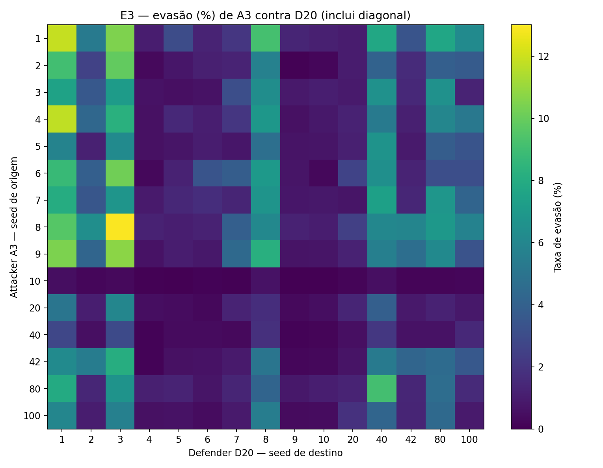
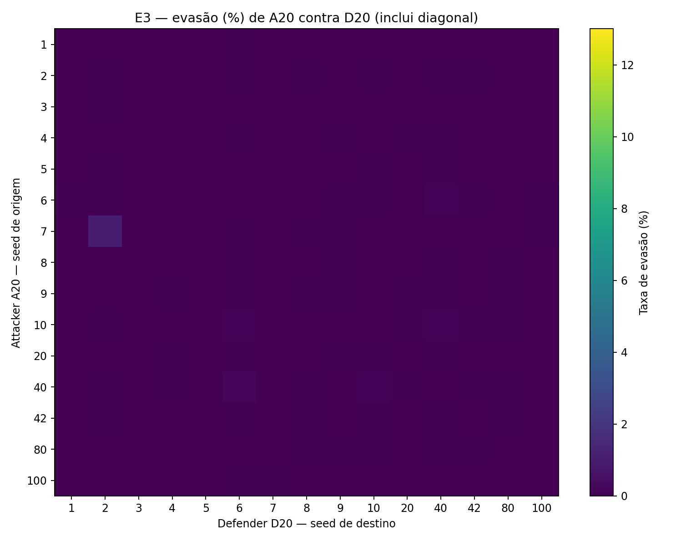
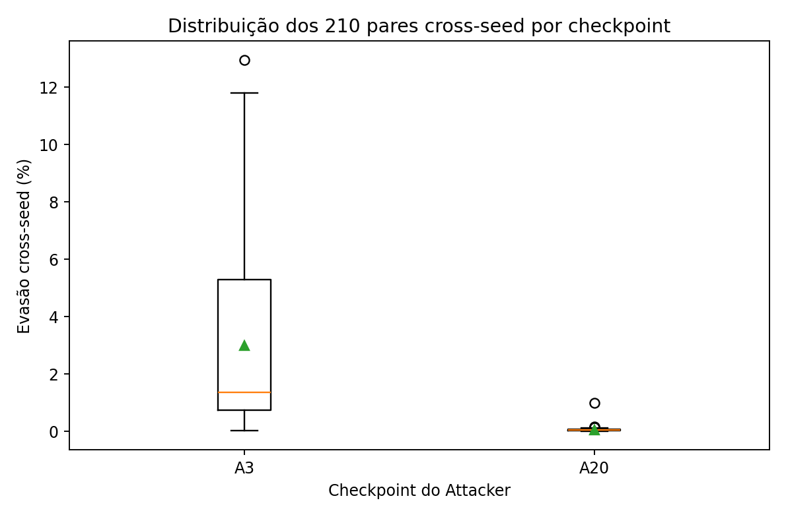
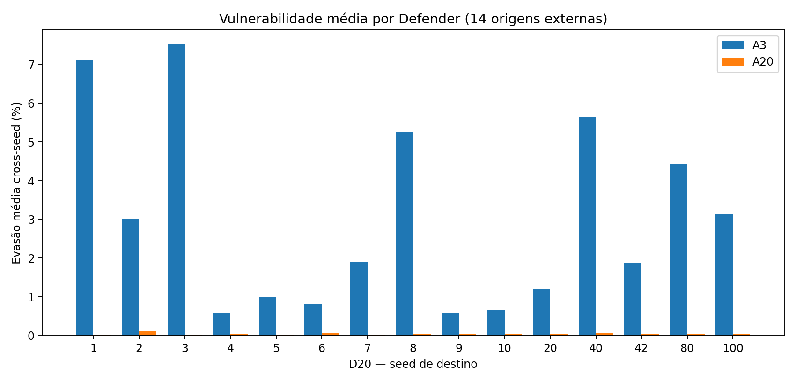
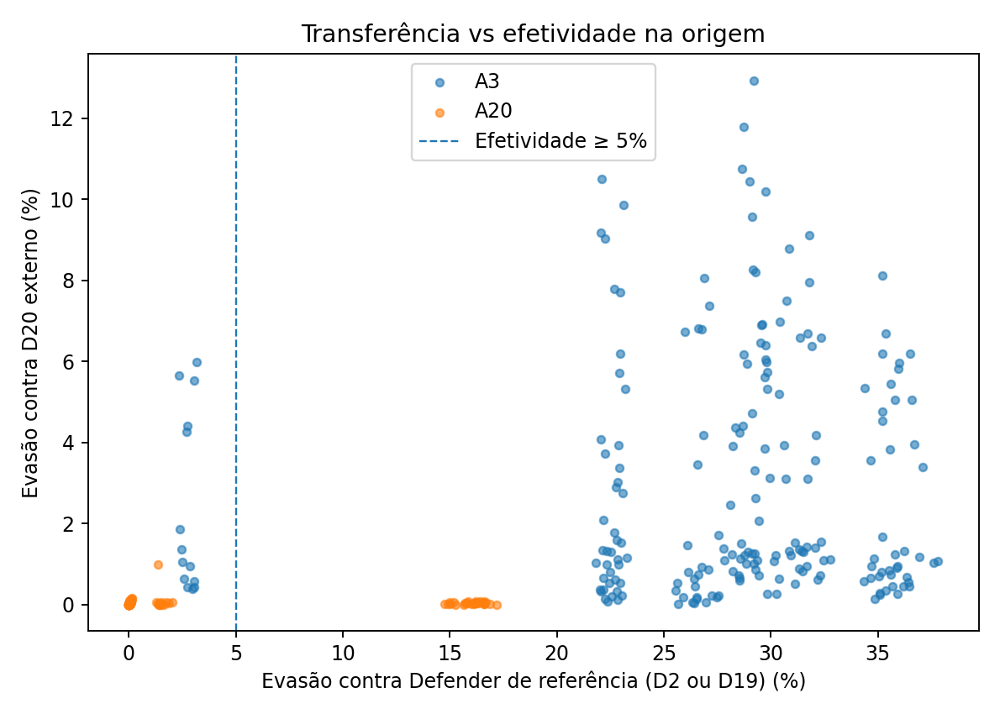

# E3 — Transferência adversarial entre seeds

**Estado: concluído no escopo E3-P + E3-A (17/11/2026).** O E3-B (sensibilidade a novos ruídos ou Attackers adaptados) permanece uma extensão opcional, **não executada** e não necessária para a conclusão descritiva da campanha principal.

## 1. Pergunta e contexto

**Pergunta:** perturbações produzidas por Attackers de uma execução conseguem evadir Defenders treinados em outra execução, com seed diferente e sem exposição direta àquele checkpoint do Attacker?

O E0 observou estabilidade parcial da adaptação, além de forte recorrência de A3 como ataque histórico residual. O E1 isolou o benefício da atualização adversarial, e o E2 estudou a transferência temporal dentro da mesma trajetória. O E3 testa **transferência cross-seed**, isto é, entre trajetórias de treinamento distintas, mas ainda no **mesmo CIC-IDS2017, com a mesma arquitetura e hiperparâmetros**. Não se trata de generalização entre datasets ou famílias novas de ataque.

## 2. Hipóteses e delineamento

- **H1 — Transferência parcial:** Attackers históricos mantêm alguma evasão contra D20 de outras seeds, mas sem uniformidade.
- **H2 — Dependência do checkpoint:** A3 e A20 apresentam padrões de transferência distintos.
- **H3 — Dependência da origem e do destino:** origem do Attacker e Defender de destino influenciam a evasão observada.

Foram reutilizadas as **15 seeds do E0**: `1–10, 20, 40, 42, 80, 100`, os Attackers **A3/A20** e os Defenders **D20**, além de **D2** e **D19** como referências de efetividade na origem. Os modelos ficaram congelados; **não houve novo treinamento**.

Cada um dos dois checkpoints foi avaliado contra os 15 Defenders, formando uma matriz `15 × 15`: **225 combinações por checkpoint**, das quais **210 cruzadas e 15 diagonais**. No total, foram **450 combinações**. Para cada combinação foram produzidas três avaliações: contra D20 de destino, contra D20 da mesma trajetória do atacante e contra o Defender anterior relevante (D2 para A3, D19 para A20). O arquivo contém **1.350 registros**; esses registros adicionais são **controles**, não execuções independentes.

### 2.1 Pré-validação e normalização

A pré-validação (`preflight.json`) registrou `status = validado`, 15 seeds, 77 features e reconstrução dos splits (154.884 treino; 22.127 validação; 44.253 teste por seed). O script verifica checkpoints, nomes e ordem das features, parâmetros e preprocessadores. Essa validação foi executada no ambiente com CIC-IDS2017; a presente consolidação estatística foi feita a partir dos artefatos de saída, sem retreinar os modelos.

Por par de seeds, as amostras vêm da **interseção teste/teste**, evitando amostras de treino das duas execuções envolvidas. Houve até 5.000 amostras DDoS por par; em **duas direções do par 5–100** havia 4.997. A pré-validação mostrou interseções cruzadas entre 4.997 e 5.234 amostras DDoS. Os pares com origem/destino trocados utilizam a mesma interseção amostral, e todas as três avaliações de uma combinação usam exatamente as mesmas amostras e o mesmo ruído. Na campanha com 15 seeds, as diagonais foram avaliadas em seu próprio teste e, portanto, **não devem ser comparadas ingenuamente às células cruzadas**; a referência pareada correta é `controle_mesma_trajetoria` do próprio par.

As perturbações são geradas no espaço normalizado da **origem** com `epsilon = 0,3`, convertidas para a representação bruta e então normalizadas pelo scaler do Defender avaliado. O limiar de classificação foi `0,5`. O ruído foi determinístico com `noise_seed = 2026`, sem replicações independentes de ruído.

### 2.2 Métricas e controles

- **Evasão no destino:** fração de amostras DDoS adversariais classificadas como benignas por D20 de destino.
- **Evasão limpa:** fração de DDoS originais não detectadas pelo Defender avaliado.
- **Sucesso condicionado:** fração que passou a ser classificada como benigna entre as DDoS corretamente detectadas antes da perturbação.
- **Controle da mesma trajetória:** o mesmo Attacker, ruído e amostras avaliados contra seu D20 de origem.
- **Efetividade na origem:** o mesmo Attacker, ruído e amostras avaliados contra D2 (para A3) ou D19 (para A20).

O limiar **≥5% de evasão na referência de origem** é um filtro exploratório de efetividade, não uma alegação de garantia física do ataque.

## 3. Resultados da campanha

### 3.1 Integridade e cobertura

A consolidação identificou as 450 combinações planejadas e as 1.350 avaliações. Não houve chaves duplicadas ou controles com amostras divergentes. A contagem de evasões reconcilia com `evasoes / n`, e o controle de amostras limpas reconcilia com a contagem de detecção.

O piloto anterior (seeds 20 e 42) havia usado a mesma base teste/teste até nas diagonais; a campanha com 15 seeds utiliza bases por par. Por essa razão, diferenças pontuais entre os números do piloto e os da campanha **não representam regressão dos modelos**.

### 3.2 Taxas de evasão cross-seed

| Indicador | A3 | A20 |
|---|---:|---:|
| Pares cruzados | 210 | 210 |
| Evasão média contra D20 externo | **2,985%** | **0,046%** |
| Evasão mediana | **1,35%** | **0,04%** |
| Maior evasão | **12,94%** | **0,98%** |
| Pares com evasão ≥1% | **136/210** | **0/210** |
| Pares com evasão ≥5% | **56/210** | **0/210** |
| Média de evasão nas amostras limpas (mesmos pares) | 0,049% | 0,049% |

Em comparações **pareadas sobre os mesmos 210 pares**, o A3 apresentou maior evasão que A20 em **208**, com **dois empates e nenhuma inversão**. A diferença média foi de **2,939 pp**. Um bootstrap exploratório com reamostragem de seeds de origem **e** destino (12.000 replicações, exclusão das diagonais reais) estimou IC de 95% em **[1,69; 4,36] pp** para essa diferença.

Para a evasão cross-seed média, os intervalos exploratórios foram **[1,73; 4,40]%** (A3) e **[0,033; 0,067]%** (A20). Esses intervalos não devem ser interpretados como 210 observações independentes: cada Attacker e cada Defender participam repetidamente de diferentes pares.



*Figura 1 — Evasão de A3 contra todos os D20. Diagonal exibida para contexto; a base amostral própria de cada célula exige comparação pareada com o controle da mesma trajetória.*



*Figura 2 — Evasão de A20 contra D20, com a mesma escala de cores da Figura 1 para comparação visual.*



*Figura 3 — Distribuição das taxas de evasão nos pares cruzados.*

### 3.3 Dependência do Defender de destino

A evasão média de A3 externo variou consideravelmente entre os Defenders de destino, com valores mais altos em **D20 da seed 3 (7,51%)**, **seed 1 (7,10%)**, **seed 40 (5,65%)**, **seed 8 (5,27%)** e **seed 80 (4,43%)**. O maior caso individual ocorreu para **A3 da seed 8 contra D20 da seed 3: 12,94%**.

A comparação **pareada** do A3 externo com o **mesmo A3 contra seu próprio D20 nas mesmas amostras** teve diferença média (destino menos controle de origem) de **−0,280 pp**, com IC bootstrap exploratório de 95% **[−2,18; 1,55] pp**. Não há evidência suficiente, nesse agregado, de uma penalidade sistemática por trocar D20 da própria trajetória por um D20 externo. O comportamento, entretanto, depende muito do par.



*Figura 4 — Médias por Defender de destino considerando as 14 origens externas.*

### 3.4 Efetividade na origem e interpretação da transferência

O controle contra o Defender de referência mostrou uma diferença importante:

| Indicador | A3 contra D2 da origem | A20 contra D19 da origem |
|---|---:|---:|
| Pares cross-seed com evasão de referência ≥5% | **196/210** | **28/210** |
| Seeds de origem representadas nesse subconjunto | **14/15** | **2/15** |
| Evasão média na referência, apenas entre os pares efetivos | **29,19%** | **16,01%** |
| Evasão média contra D20 externo nesse mesmo subconjunto | **3,03%** | **0,039%** |

Apenas o A3 da **seed 100** ficou abaixo do filtro de 5% contra D2 nos 14 pares externos. Para A20, os 28 pares efetivos estão concentrados nos atacantes das **seeds 42 e 100**. Isso mostra que **a baixa evasão de A20 no destino não pode ser explicada exclusivamente pela resistência do Defender externo**: em 182/210 pares, o gerador também foi pouco eficaz contra sua referência D19.

Ainda assim, nas **28 comparações em que A20 era efetivo contra D19**, a evasão média contra D20 externo foi de apenas **0,039%**. Já A3 manteve evasão externa média de **3,03%** nos 196 pares efetivos contra D2. Esse filtro fortalece a interpretação de que ambos têm padrões de transferência distintos, mas D2/D19 são estágios diferentes e a comparação **não isola causalmente o efeito da rodada**.



*Figura 5 — Evasão na referência da origem versus no D20 de destino. Linha vertical: filtro exploratório de 5%.*

## 4. Discussão das hipóteses

- **H1: sustentada para A3, não generalizável para todo checkpoint.** Há transferência parcial, não uniforme, entre seeds, inclusive em numerosos pares com eficácia prévia do atacante. Para A20, a transferência observada foi muito baixa.
- **H2: sustentada descritivamente.** A3 superou A20 em 208/210 pares cruzados. Essa diferença não prova uma causa arquitetural exclusiva da terceira rodada: a própria efetividade contra Defenders de referência também difere entre A3 e A20.
- **H3: sustentada descritivamente.** A evasão depende fortemente do Defender de destino e também do atacante de origem. Por exemplo, D20 das seeds 3 e 1 tiveram médias muito superiores às de D20 das seeds 4 e 9. Não há conclusão causal sobre quais aspectos do split, scaler ou inicialização explicam essas diferenças.

## 5. Limitações

1. **Uma só realização de ruído** por par de seeds. Reexecutar com outros `noise_seed` seria uma análise de sensibilidade útil, mas está fora desta campanha.
2. **Dependência entre comparações.** Os 210 pares de cada checkpoint compartilham Attackers, Defenders e amostras. Os ICs são exploratórios e empregam reamostragem em dois eixos de seeds; não são garantias de inferência populacional.
3. **Mesmo dataset e mesma arquitetura.** Cross-seed não equivale a ataque totalmente independente, mudança de distribuição ou novas famílias de ataque.
4. **Seed altera split, normalização e treinamento.** A matriz não permite separar esses efeitos causalmente.
5. **A3 selecionado após E0.** É um checkpoint motivado por um achado anterior, não uma descoberta independente pré-registrada.
6. **Perturbações em features normalizadas.** `epsilon=0,3` não garante consistência física ou reconstrução de pacotes/fluxos reais. Evasão é uma propriedade do protocolo offline utilizado.
7. **Interseções teste/teste por par.** A base muda entre pares; os controles pareados reduzem, mas não eliminam, o risco de interpretações equivocadas ao comparar médias brutas de pares distintos.

## 6. Conclusão do E3

O E3 encontrou **transferência adversarial parcial entre seeds para A3**. A taxa de evasão variou amplamente com o Defender de destino, e houve pares em que a evasão do A3 externo superou 10%, mesmo sem adaptação direta do D20 àquele checkpoint específico. Ao mesmo tempo, a evasão de A20 contra Defenders externos foi próxima de zero em quase toda a matriz, inclusive no subconjunto em que A20 era efetivo contra D19.

Os achados demonstram que **robustez dentro da própria trajetória e resistência a ataques de outras seeds não são a mesma propriedade**, mas também que a transferência depende da eficácia do atacante, do checkpoint e do destino. Não é adequado concluir robustez adversarial absoluta ou generalização fora do CIC-IDS2017.

**Encerramento:** E3-P (piloto) e E3-A (campanha principal) concluídos. O E3-B com ruídos alternativos ou outros Attackers permanece opcional e **não foi realizado**; seus resultados não fazem parte desta conclusão. O estudo de outras distribuições deve ser tratado separadamente no E4.

## 7. Reprodutibilidade e organização

Dados e scripts:

- `e3_assets/data/preflight.json` — pré-validação das 15 seeds.
- `e3_assets/data/resultados.csv` e `resultados.json` — 1.350 avaliações originais, incluindo controles.
- `e3_assets/data/e3_pares_consolidados.csv` — 450 combinações com controles pareados e diferenças em pp.
- `e3_assets/data/e3_resumo_por_checkpoint.csv`, `e3_resumo_por_origem.csv`, `e3_resumo_por_destino.csv` — resultados agregados.
- `e3_assets/data/e3_estatisticas.json` — indicadores consolidados, filtro de efetividade e ICs.
- `docs/scientific/scripts/e3_preflight.py` — pré-validação.
- `docs/scientific/scripts/e3_cross_seed.py` — avaliação cruzada.
- `docs/scientific/scripts/e3_analise.py` — consolidação e figuras reproduzíveis.

Para refazer a análise **sem retreinar modelos**, a partir da raiz do repositório:

```bash
uv run python docs/scientific/scripts/e3_analise.py \
  --input models/e3/campanha/resultados.csv \
  --output-dir docs/scientific/e3/e3_assets
```

A coleta original foi executada com `--seeds 1 2 3 4 5 6 7 8 9 10 20 40 42 80 100 --n-eval 5000`; a seleção e o ruído registrados foram `2026`. O script de análise não modifica checkpoints nem resultados de treino.
