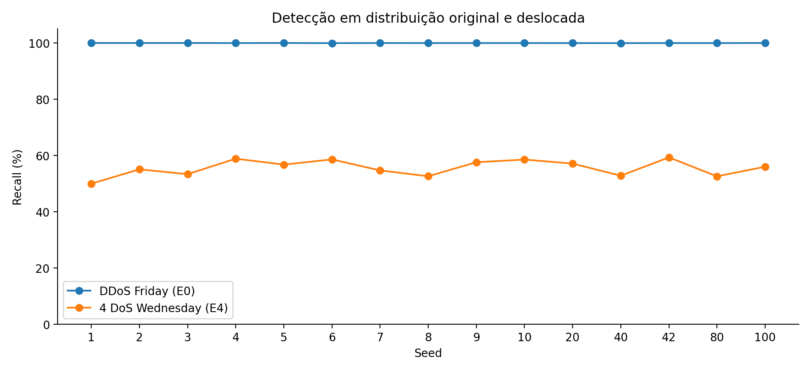
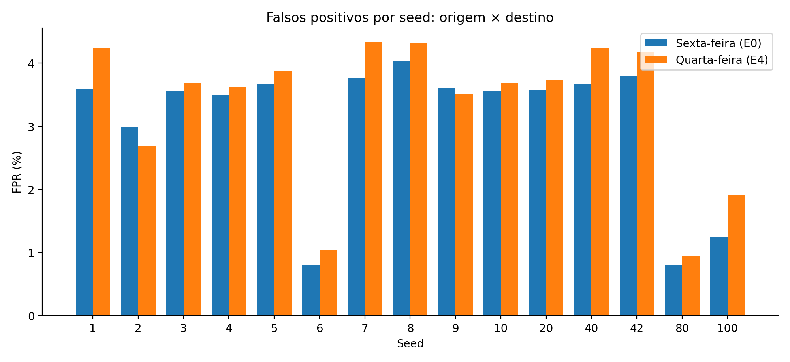
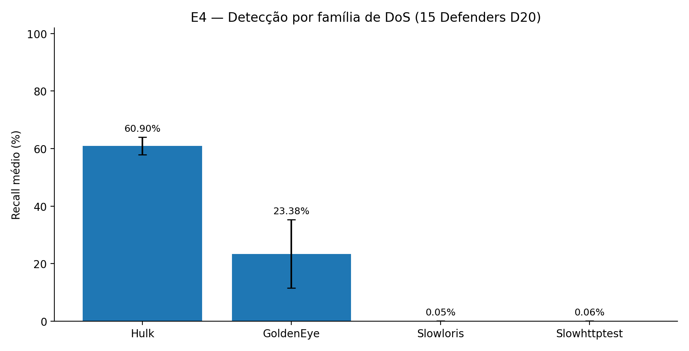
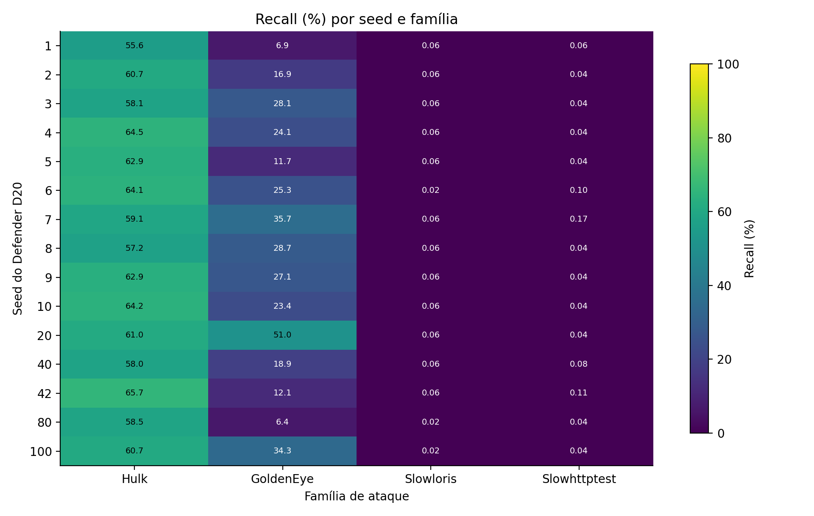
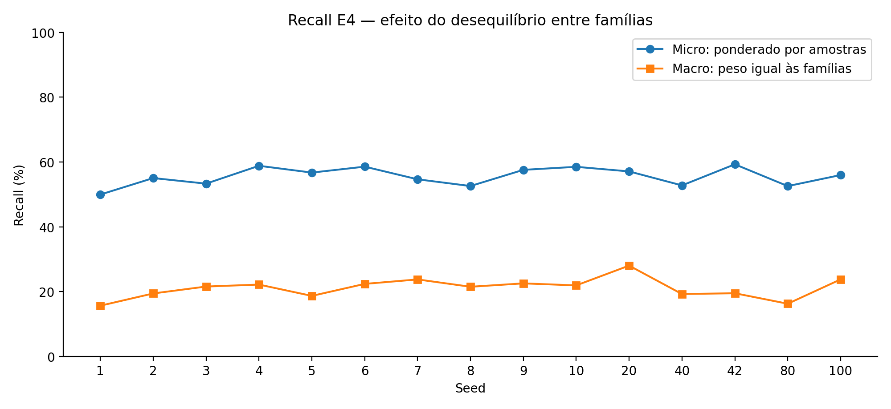
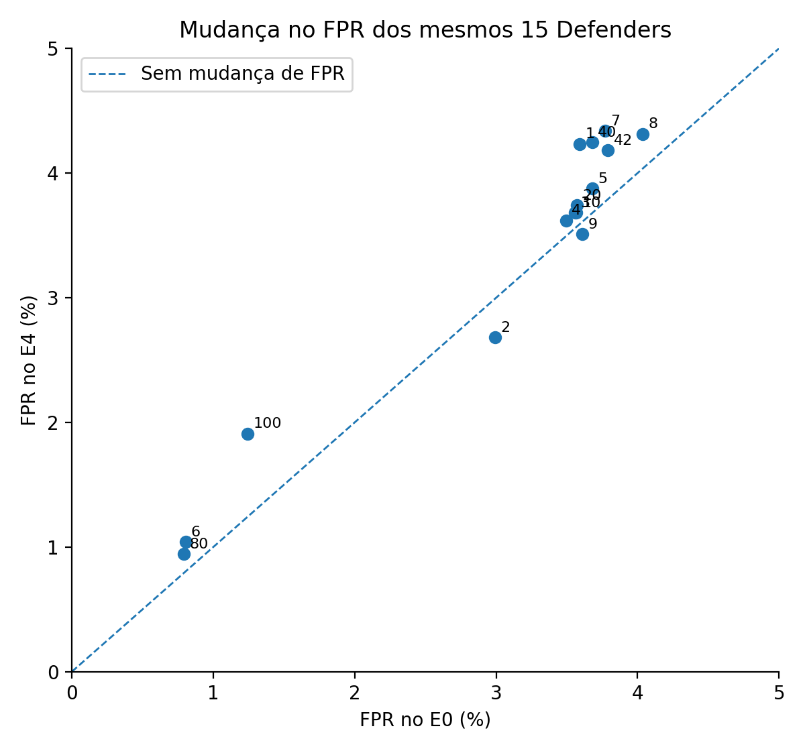

# E4 — Generalização sob mudança de distribuição

**Estado:** E4-P e E4-A concluídos (17/11/2026). Encerrado o escopo primário com avaliação entre dias/famílias do CIC-IDS2017. E4-B em corpus independente não foi executado e permanece como extensão opcional.

## 1. Pergunta e hipóteses

**Pergunta:** um Defender D20 treinado em dados benignos e DDoS da sexta-feira mantém sua capacidade de classificação quando é avaliado, **sem retreinamento**, em tráfego benigno e quatro variantes DoS da quarta-feira?

- **H1 — Queda de detecção fora da distribuição:** a sensibilidade a pelo menos uma família de ataque será diferente daquela observada em DDoS da origem.
- **H2 — Heterogeneidade por família:** diferentes variantes DoS terão sensibilidades diferentes.
- **H3 — Mudança de falsos positivos:** o FPR nos benignos externos poderá diferir do FPR original.
- **H4 — Variabilidade entre seeds:** os 15 D20 podem responder diferentemente ao deslocamento de distribuição.

A avaliação é **offline, com exemplos não perturbados**. Ela mede generalização de classificação sob mudança conjunta de dia e família de ataque; não mede evasão de um Attacker neural nem permite isolar causalmente o motivo do deslocamento.

## 2. Dados e procedimento

### 2.1 Origem e destino

A referência do E0 é `data/DDoS-Friday-no-metadata.parquet` (221.264 amostras; 77 features), com modelo D20, split e `StandardScaler` persistidos separadamente para cada uma das seeds `1–10, 20, 40, 42, 80, 100`. Para a comparação de desempenho convencional, foi usado **somente o teste reservado do E0**, com 44.253 amostras por seed (18.650 benignas e 25.603 DDoS).

O destino é `data/DoS-Wednesday-no-metadata.parquet`, **584.991 linhas**, SHA-256 `660577146c53fc467ccfa3124d5061e037238f03e936eb1fff914dba08d4104b`:

| Rótulo original | Linhas |
|---|---:|
| Benign | 391.235 |
| DoS Hulk | 172.846 |
| DoS GoldenEye | 10.286 |
| DoS slowloris | 5.385 |
| DoS Slowhttptest | 5.228 |
| Heartbleed | 11 |

O auditor confirmou **77 features nominalmente compatíveis**, mesma ordem e ausência reportada de valores ausentes, não numéricos ou infinitos nas features coincidentes. A equivalência semântica, as unidades e a implementação efetiva de extração dos atributos dependem da proveniência dos arquivos e não são demonstradas apenas pelos nomes das colunas.

### 2.2 Pré-validação e prevenção de sobreposição

- Os checkpoints **D20 de todas as 15 seeds** foram congelados; sem `fit` do scaler, recalibração de threshold ou novo treinamento.
- Para cada seed, os pesos e scaler originais reproduziram **exatamente a matriz de confusão do teste do E0** (`validacao_origem.json`). O limiar foi `0,5`.
- Para reduzir risco de contaminação, foram removidas da avaliação de cada Defender as linhas de quarta-feira cujas **77 features brutas coincidiam exatamente** com alguma linha do treino dessa seed: de **431 a 476** exclusões por seed, todas da classe **Benign**. Não houve exclusões por sobreposição nas quatro famílias DoS.
- As 11 linhas de Heartbleed ficaram fora da avaliação principal. O número de registros retidos varia levemente entre seeds porque a filtragem do treino é específica do Defender (aproximadamente 584,5 mil amostras por modelo).

A igualdade das features é uma precaução conservadora: **não comprova identidade entre fluxos de rede** e não detecta correspondências aproximadas. A campanha gerou `auditoria_intersecao.json` com contagens individuais por classe e seed.

### 2.3 Métricas e agregação

O FPR foi calculado exclusivamente em amostras `Benign` retidas. O recall/FNR por família usa cada família como positiva; não considera Heartbleed. O **recall micro** reúne os 193.745 ataques de quarta-feira e pesa as famílias pelo número de linhas. O **recall macro** é a média simples dos quatro recalls por família (mesmo peso para cada uma).

Os resultados foram calculados por seed e depois resumidos com **média e desvio padrão amostral dos 15 Defenders**. Os intervalos exploratórios de 95% foram obtidos por **20.000 reamostragens de seeds completas**, preservando o pareamento E0/E4 de cada modelo. Como todos avaliam o mesmo dataset externo e as seeds também alteram os splits e os scalers, esses intervalos não representam 15 novos corpora independentes nem inferência causal.

## 3. Resultados da campanha

### 3.1 Integridade e cobertura

Foram identificadas **15/15 seeds**, **75 registros família × seed**, sem chaves repetidas, contagens incompatíveis ou divergências nas matrizes de referência. A campanha está registrada como `concluido` no `resumo.json`. Todas as métricas de família satisfazem `pred_ataque + pred_benigno = n`.

### 3.2 Comparação geral E0 × E4

| Indicador (média entre seeds) | E0 — DDoS Friday | E4 — DoS Wednesday |
|---|---:|---:|
| Recall para ataques | **99,95%** | **55,57%** |
| FPR benigno | **3,08%** | **3,33%** |

O recall caiu, em média, **44,38 pontos percentuais**, com IC bootstrap exploratório de 95% para a diferença E4−E0 de **[-45,79; -43,02] pp**. A média de recall global no E4 variou entre **49,96%** e **59,29%** entre os modelos.

O FPR aumentou, em média, **0,26 pp**, com IC bootstrap exploratório de 95% **[0,12; 0,39] pp**, e incremento em **13/15 seeds**. Como o tráfego benigno também veio de outro dia, a diferença não pode ser atribuída apenas às novas famílias de DoS.



*Figura 1 — Recall no teste original da sexta-feira e no dataset deslocado de quarta-feira, por seed. São distribuições e famílias distintas, não duas medidas do mesmo ataque.*



*Figura 2 — FPR por seed, avaliado separadamente nos respectivos benignos de sexta e quarta-feira.*

### 3.3 Desempenho por família de DoS

| Família | Recall médio (%) | Desvio padrão entre seeds (pp) | Mín–máx (%) | FNR médio (%) |
|---|---:|---:|---:|---:|
| DoS Hulk | 60,90 | 3,08 | 55,59–65,74 | 39,10 |
| DoS GoldenEye | 23,38 | 11,92 | 6,45–51,05 | 76,62 |
| DoS slowloris | 0,05 | 0,02 | 0,02–0,06 | 99,95 |
| DoS Slowhttptest | 0,06 | 0,04 | 0,04–0,17 | 99,94 |

A dificuldade foi fortemente heterogênea: **Hulk** apresentou recall médio de aproximadamente **60,90%**, **GoldenEye** de **23,38%**, enquanto **Slowloris** e **Slowhttptest** ficaram próximos de **zero** em todas as seeds. A faixa de GoldenEye foi particularmente ampla (**6,45%–51,05%**), indicando sensibilidade à configuração/treinamento representados pela seed.



*Figura 3 — Média ± desvio padrão de recall por família nas 15 seeds.*



*Figura 4 — Recall de cada família em cada Defender D20; a escala comum realça a quase ausência de detecção nas duas variantes lentas.*

### 3.4 O desequilíbrio entre famílias mascara a limitação

**Hulk representa 89,21% dos ataques de quarta-feira.** Por isso, o recall **micro de 55,57%** é dominado por Hulk e não descreve adequadamente as quatro famílias com igual importância.

Ao atribuir o mesmo peso a cada família, o recall **macro médio é 21,10%** (IC bootstrap exploratório de 95% **[19,60; 22,66]%**). Isso reforça que o desempenho global é sustentado por uma família dominante, enquanto as variantes lentas passam praticamente despercebidas.



*Figura 5 — Comparação de agregação micro e macro, por seed.*

### 3.5 Variabilidade de FPR e relação com a origem

O FPR médio no E4 foi de **3,33% ± 1,15 pp**, com intervalo entre **0,95% e 4,34%**. As seeds **6, 80 e 100** permaneceram entre as de menor FPR, como observado no E0, mas isso não significa que tenham melhor recall em todas as famílias.

A correlação descritiva de Pearson entre os FPRs das mesmas 15 seeds no E0 e E4 foi **0,971**. Isso aponta consistência da ordenação relativa dos modelos quanto a falsos positivos entre os dois conjuntos benignos, sem estabelecer a causa.



*Figura 6 — FPR por Defender nos dois dias; a linha tracejada indica igualdade das taxas.*

## 4. Discussão das hipóteses

- **H1 — Sustentada no contraste entre os domínios testados.** O recall de DDoS de sexta-feira era próximo de 100%; o recall em ataques DoS de quarta-feira foi muito inferior, sobretudo nas variantes lentas. Não é possível atribuir causalmente a diferença a uma única mudança de família ou dia.
- **H2 — Fortemente sustentada descritivamente.** As quatro famílias apresentam taxas de detecção radicalmente diferentes. O recall global agregado mascara essa heterogeneidade.
- **H3 — Sustentada como mudança mensurável, de magnitude média pequena.** O FPR aumentou em média 0,26 pp, mas houve seeds em que diminuiu.
- **H4 — Sustentada descritivamente.** Há variação relevante especialmente no recall de GoldenEye (6,45%–51,05%) e no FPR de quarta-feira (0,95%–4,34%). O experimento não separa efeitos de inicialização, split e normalização.

## 5. Limitações

1. **Shift combinado**: dia, contexto de captura, predominância de protocolos/fluxos e família de ataque mudam ao mesmo tempo; não há identificação causal da fonte da queda.
2. **Mesmo corpus e schema nominal**: quarta-feira pertence ao CIC-IDS2017 e não é uma validação em corpus independente; compatibilidade de 77 nomes não prova equivalência de extração/unidades, embora a procedência declarada dos arquivos e os testes favoreçam a comparação.
3. **Mesmo dataset externo avaliado 15 vezes**: os modelos não produzem 15 amostras independentes do tráfego. Os intervalos de bootstrap são exploratórios entre modelos.
4. **Critério conservador de sobreposição**: igualdade exata de 77 features brutas não prova identidade do fluxo nem elimina duplicações aproximadas; as exclusões foram todas benignas, em número ligeiramente diferente por seed.
5. **Dataset e prevalências diferentes**: precisão, F1 e métricas sensíveis à prevalência não foram usadas na comparação principal. A agregação micro é fortemente dominada pelo ataque Hulk.
6. **Classificador congelado**: o E4 não aplica defesa adaptativa, recalibração de limiar nem perturbações adversariais, e não testa se novos treinamentos conseguiriam recuperar o recall.
7. **Agregados disponíveis**: o ZIP da campanha conserva contagens e média de score por classe/seed, não os scores individuais. Não foi possível reconstruir distribuições de score, curvas ROC/PR ou avaliar limiares alternativos sem nova inferência.

## 6. Conclusão

O E4-A mostrou que **o desempenho elevado no domínio original DDoS não se transfere uniformemente para ataques DoS de outra distribuição**. Os D20 preservaram um FPR médio relativamente próximo ao da origem, mas apresentaram perda de aproximadamente **44,38 pp** no recall global; para Slowloris e Slowhttptest, a detecção ficou próxima de zero. Mesmo o recall global de 55,57% deve ser interpretado junto ao **recall macro de 21,10%**, que evidencia a dificuldade nas famílias menos frequentes.

Assim, **E4-P e E4-A estão concluídos** e o objetivo primário de investigar o deslocamento entre dias/famílias foi atendido. Uma avaliação E4-B em corpus genuinamente independente ou uma análise de re-treinamento/calibração exigiria desenho metodológico próprio, não sendo necessária para declarar esta etapa concluída. Este resultado delimita o alcance dos ganhos de adaptação e transferência observados em E1–E3.

## 7. Reprodutibilidade e arquivos

- Dataset de origem: `data/DDoS-Friday-no-metadata.parquet` e seus 15 runs/checkpoints D20 do E0.
- Dataset avaliado: `data/DoS-Wednesday-no-metadata.parquet`; SHA-256 registrado na seção 2.
- Script executado: `docs/scientific/scripts/e4_piloto.py`, com filtro vetorizado e teste do E0 por seed.
- Registros originais: `e4_assets/data/metricas_por_seed_familia.csv`, `e4_assets/data/validacao_origem.json`, `e4_assets/data/auditoria_intersecao.json`, `e4_assets/data/resumo.json`.
- Consolidação: `e4_assets/data/resumo_por_seed.csv` e `e4_assets/data/resumo_estatistico.json`; seis figuras em `e4_assets/figures/`.
- Comando original (na raiz do projeto):

```bash
uv run python docs/scientific/scripts/e4_piloto.py \
  --dataset data/DoS-Wednesday-no-metadata.parquet \
  --audit-file models/e4/preflight/auditoria_dataset.json \
  --seeds {1..10} 20 40 42 80 100 \
  --output-dir models/e4/campanha
```

**Observação de auditoria:** o conteúdo completo de `models/e4/preflight/auditoria_dataset.json` não foi incluído no ZIP da campanha. A consolidação verificou os artefatos produzidos; o próprio executor do E4-A exige pré-validação de schema, qualidade e duplicatas antes de concluir a execução.
