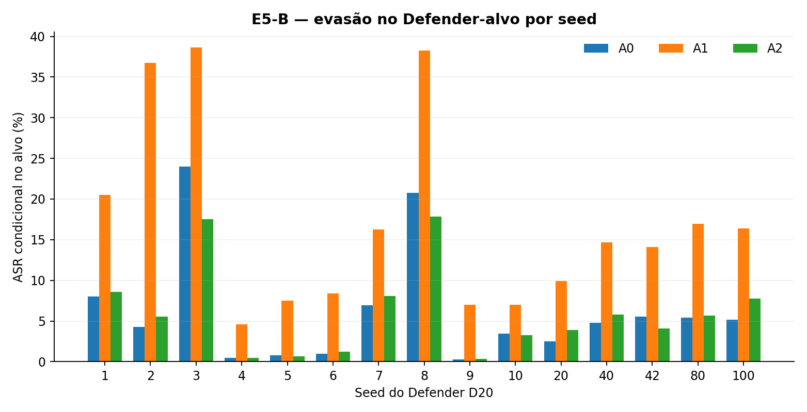
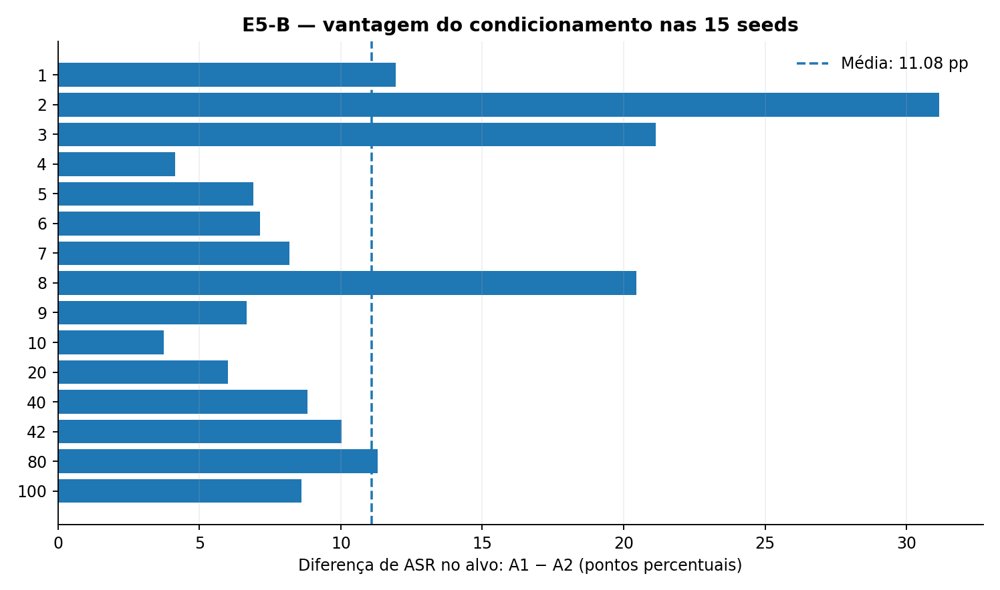
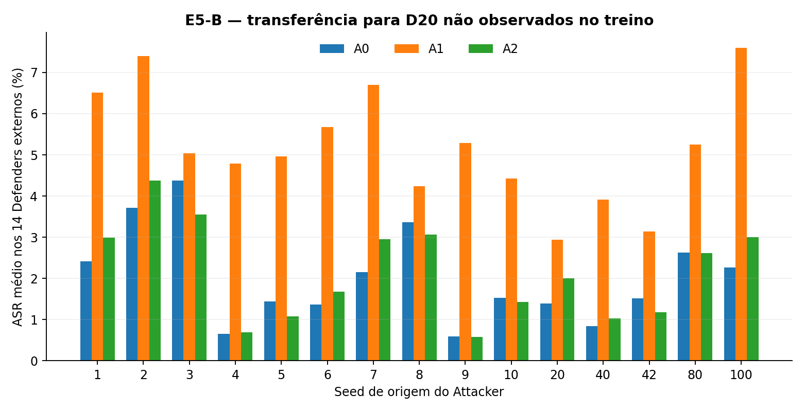
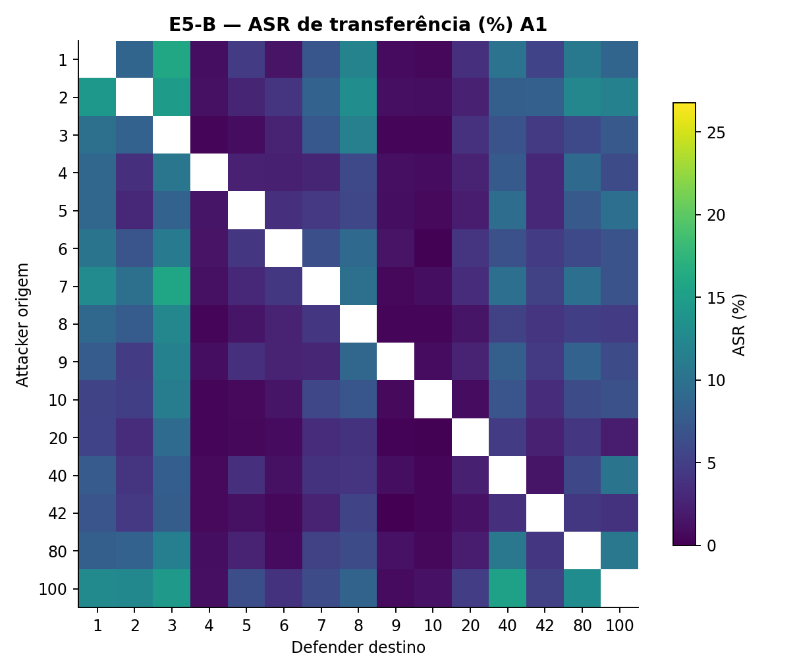
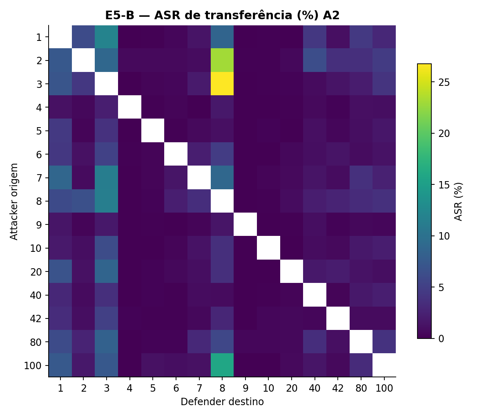
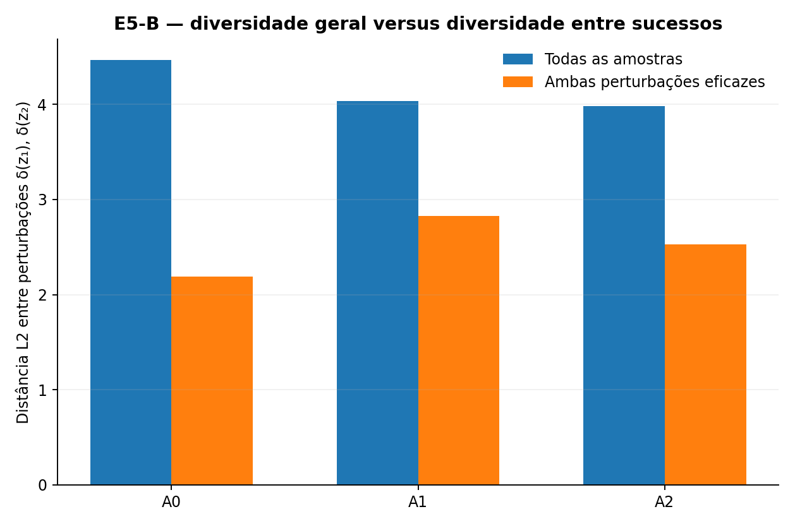

# E5 — Evolução do Attacker: eficácia, diversidade e transferência adversarial

**Estado:** E5-P, E5-A, E5-A2, E5-A3 e E5-B concluídos e analisados em 24/11/2026. E5-C (gerador explicitamente probabilístico) **não executado**, reservado como extensão opcional.

## 1. Motivação e pergunta científica

Os experimentos anteriores da ADArena indicaram adaptação dos Defenders a perturbações adversariais no domínio DDoS de sexta-feira (E0–E2), transferência parcial de Attackers históricos entre seeds (E3) e baixa generalização dos D20 a famílias DoS de quarta-feira (E4). O E5 não tenta corrigir a generalização interdomínio de E4: ele testa, **no domínio de sexta-feira**, como a arquitetura e a otimização do Attacker alteram a eficácia e a transferência adversarial contra **D20 congelados**.

**Pergunta principal:** sob a mesma origem de dados, Defender, orçamento de perturbação e treinamento, acrescentar condicionamento explícito pela amostra `x` melhora a evasão e a transferência, além do que se obtém apenas aumentando a capacidade paramétrica do gerador?

**Hipóteses:**

- **H1 (eficácia):** A1 tem maior ASR no Defender-alvo do que A0 e A2.
- **H2 (diversidade):** A1 aumenta a dispersão de perturbações geradas para a mesma amostra, incluindo variantes eficazes.
- **H3 (transferência):** A1 produz ataques com maior evasão contra outros D20 não usados na otimização.
- **H4 (estabilidade):** a diferença entre arquiteturas apresenta variação entre seeds e repetições.

## 2. Desenvolvimento do E5

- **E5-P — Preflight:** verificou nas seeds 20 e 42 a integridade dos checkpoints A20/D20, scaler, splits sem interseção registrada, Defender congelado e igualdade inicial exata entre A0 e A1 (`diferença máxima = 0`). A campanha E5-B exigiu novo preflight para todas as 15 seeds.
- **E5-A — Piloto BCE em probabilidades:** 12 treinamentos em seeds 20/42, três repetições e A0/A1; o ASR foi baixo (médias de cerca de **0,63%/0,65%**). Não houve evidência estável de melhora por condicionamento sob essa perda.
- **E5-A2 — Correção de otimização:** substituiu a BCE sobre probabilidades saturadas pela `BCEWithLogitsLoss` aplicada aos **logits reais anteriores à Sigmoid**, mantendo D20 congelado. A0/A1 passaram a aproximadamente **3,80%/12,40%** no piloto de duas seeds. A comparação não isola por si só condicionamento de capacidade.
- **E5-A3 — Ablação de capacidade:** introduziu A2, com tamanho semelhante a A1 mas entrada restrita a `z`. No piloto de duas seeds, A1 apresentou ASR **12,39%**, contra **4,02% (A2)** e **3,79% (A0)** nas avaliações então realizadas.
- **E5-B — Campanha ampliada:** avaliou as três arquiteturas nas 15 seeds originais do E0; este relatório apresenta os resultados definitivos **sob um novo protocolo unificado de avaliação**. Diferenças pequenas em relação às médias dos pilotos decorrem também de amostras e ruído de teste redefinidos no E5-B, não de retreinamento dos 18 checkpoints reaproveitados.

## 3. Delineamento do E5-B

### 3.1 Dados, arquiteturas e controles

O dataset é o **CIC-IDS2017 — DDoS Friday**, `data/DDoS-Friday-no-metadata.parquet` (221.264 registros e 77 features). Cada execução reutiliza os splits, scaler, A20 histórico e **D20 congelado** da sua seed E0. Todas as arquiteturas geram perturbações `δ ∈ [-1,1]` no espaço padronizado das 77 features, aplicadas como `x_adv = x + εδ`, com **ε = 0,3** e classificação por limiar **0,5**.

| Braço | Gerador | Parâmetros | Papel |
|---|---|---:|---|
| **A0** | `G(z)` histórico, continuado de A20 | 64.013 | Baseline original |
| **A1** | `G(x,z)` com ramo residual condicional | 104.538 | Arquitetura proposta |
| **A2** | `G(z)` com ramo adicional, sem acesso a `x` | 104.482 | Ablação de capacidade quase equivalente à de A1 |

A0, A1 e A2 começam com saída equivalente à do A20. Cada treinamento usa **3 épocas**, batch **512**, treino DDoS completo da seed, otimizador **Adam novo** (`lr=0,0002`; betas `0,5/0,999`) e perda `BCEWithLogitsLoss`. Os braços pareados compartilham ordem de minibatches, vetores `z`, inicialização histórica e orçamento de atualizações; D20 não é atualizado. O checkpoint avaliado é o **da época final fixa**, sem seleção pelo teste.

### 3.2 Cobertura e avaliações

Foram executados **15 Defenders × 3 réplicas (1042, 1043, 1044) × 3 arquiteturas = 135 treinamentos**, dos quais **117 novos** e **18 checkpoints do E5-A2/A3 reutilizados** com verificação de metadados e hash. Para cada braço houve **uma avaliação no próprio D20** e **14 transferências direcionadas** para os demais D20: **1.890 avaliações de transferência** (= 15×14×3×3), correspondentes a **210 direções distintas** por arquitetura antes das três réplicas.

- **Alvo:** até **5.000** exemplos DDoS no teste reservado da seed de origem, com os mesmos índices e mesma realização de ruído entre A0/A1/A2 por réplica.
- **Transferência:** **1.024** exemplos DDoS na interseção **teste/teste de cada par de seeds**; nem o Attacker de origem nem o Defender de destino receberam essas linhas em seus respectivos treinos. A perturbação é gerada na escala da origem, convertida ao espaço bruto e normalizada pelo scaler do destino, preservando a grandeza em relação à escala de origem. Todas as avaliações de transferência do conjunto enviado tiveram exatamente 1.024 exemplos.
- **Métrica de evasão:** `ASR = sucessos / detectados_limpos`, em que sucessos são amostras DDoS detectadas no estado original pelo Defender avaliado, mas classificadas como benignas após **uma** perturbação (`ASR@1`). Erros já presentes no fluxo limpo não contam como ataques bem-sucedidos.
- **Diversidade geral:** distância L2 média entre dois vetores `δ(x,z₁)` e `δ(x,z₂)` gerados para a **mesma** amostra e dois ruídos. A **diversidade entre sucessos** é calculada somente quando **ambas** as perturbações evadem; consequentemente, não utiliza exatamente o mesmo subconjunto em modelos de ASR distinto.
- **Agregação:** três repetições são agregadas dentro de cada seed; as estatísticas descritivas resumem depois as **15 seeds de origem**. As 1.890 transferências compartilham Attackers, Defenders e dados, portanto não formam 1.890 observações independentes. ICs exploratórios de 95% por **30.000 reamostragens de seeds completas** (percentis, gerador fixo `20261124`), preservando os pares A0/A1/A2 e as três réplicas.

### 3.3 Auditoria dos artefatos

A consolidação confirmou **135 registros de alvo**, **1.890 de transferência**, **45 grupos seed×réplica completos** e ausência de chaves duplicadas/valores ausentes. Os metadados de cada comparação pareada indicam os **mesmos índices e a mesma seed de ruído** entre os três braços; cada ASR reconcilia numericamente com `n_sucesso/n_detectados_limpos`. Verificou-se também a concordância entre métricas CSV e os JSONs individuais, inclusive os identificadores de checkpoint referenciados.

**Limite da auditoria:** o ZIP enviado exclui os arquivos `.pth`, logo a presente análise é feita sobre as métricas persistidas e **não** reexecuta a inferência nem recalcula diretamente os hashes de bytes dos checkpoints.

## 4. Resultados

### 4.1 Evasão no Defender-alvo

| Métrica (média entre 15 seeds) | A0 — original | A1 — condicional | A2 — capacidade |
|---|---:|---:|---:|
| **ASR@1 no alvo** | 6,22% | **17,13%** | 6,05% |
| **ASR@1 de transferência** | 2,02% | **5,19%** | 2,15% |
| Diversidade L2 geral | **4,47** | 4,04 | 3,98 |
| Tempo médio de treinamento por execução | 9,99 s | 14,27 s | 14,18 s |

A1 supera A2 em **11,08 pontos percentuais** de ASR no alvo, em média, com IC bootstrap exploratório de 95% **[7,79; 15,09] pp**. A vantagem A1−A0 é de **10,91 pp** (IC [7,97; 14,76] pp). Em contraste, o controle A2−A0 apresenta média de **-0,17 pp** (IC [-1,32; 0,76] pp), sem ganho uniforme com o simples aumento de parâmetros.

**Consistência do efeito:** A1 supera tanto A0 quanto A2 nas **45/45 comparações seed×réplica** e em **15/15 seeds** após agregação das réplicas. O maior ganho médio A1−A2 ocorre na seed **2 (31,15 pp)** e o menor na seed **10 (3,73 pp)**. Em A1, o ASR médio por seed varia de **4,58%** a **38,64%**.

*Figura 1 — ASR no Defender de origem, com as três réplicas agregadas por seed.*

*Figura 2 — Vantagem de A1 sobre A2 em cada seed; a linha tracejada marca a diferença média (pp).*

### 4.2 Tabela de resultados por seed

| Seed | ASR A0 | ASR A1 | ASR A2 | A1−A2 (pp) | Transferência A1 |
|---:|---:|---:|---:|---:|---:|
| 1 | 8,03% | **20,51%** | 8,58% | +11,94 | 6,51% |
| 2 | 4,28% | **36,71%** | 5,57% | +31,15 | 7,40% |
| 3 | 23,99% | **38,64%** | 17,51% | +21,13 | 5,04% |
| 4 | 0,47% | **4,58%** | 0,45% | +4,13 | 4,79% |
| 5 | 0,77% | **7,54%** | 0,63% | +6,91 | 4,96% |
| 6 | 0,95% | **8,38%** | 1,24% | +7,13 | 5,68% |
| 7 | 6,97% | **16,27%** | 8,09% | +8,17 | 6,70% |
| 8 | 20,76% | **38,27%** | 17,83% | +20,44 | 4,23% |
| 9 | 0,30% | **7,01%** | 0,35% | +6,67 | 5,28% |
| 10 | 3,42% | **7,02%** | 3,28% | +3,73 | 4,42% |
| 20 | 2,51% | **9,94%** | 3,92% | +6,01 | 2,94% |
| 40 | 4,75% | **14,65%** | 5,82% | +8,83 | 3,91% |
| 42 | 5,54% | **14,11%** | 4,08% | +10,03 | 3,14% |
| 80 | 5,40% | **16,98%** | 5,68% | +11,30 | 5,25% |
| 100 | 5,14% | **16,36%** | 7,76% | +8,60 | 7,60% |

### 4.3 Transferência adversarial

A1 apresenta média de transferência **5,19%**, contra **2,15%** em A2 e **2,02%** em A0. A diferença pareada A1−A2 é **+3,04 pp**, com IC bootstrap exploratório de **[2,45; 3,62] pp**, sendo positiva em **15/15 origens**. A1−A0 é **+3,17 pp** (IC [2,45; 3,86] pp).

Ao agregar as réplicas para cada uma das **210 direções origem→destino**, A1 supera A2 em **205/210 direções** e supera A0 em **204/210**. Isso mostra transferência **parcial e heterogênea**, não superioridade em todas as combinações.

*Figura 3 — Média de ASR entre os 14 Defenders externos, agregada por Attacker de origem.*

*Figura 4 — Transferência média de A1 em cada direção origem→destino, por três réplicas.*

*Figura 5 — Transferência média de A2 nas mesmas direções; Figura 4 e Figura 5 usam a **mesma escala visual**.*

A comparação entre o ASR no alvo (avaliado em até 5.000 DDoS do teste de origem) e o ASR de transferência (1.024 DDoS de teste/teste por par) **não é estritamente pareada na base amostral**. Assim, a diferença absoluta entre as médias dos dois cenários não pode ser interpretada, isoladamente, como perda causada apenas pela troca de Defender.

### 4.4 Diversidade e magnitude

| Indicador | A0 | A1 | A2 |
|---|---:|---:|---:|
| Diversidade L2 de todas as perturbações | **4,47** | 4,04 | 3,98 |
| Diversidade L2 entre pares **ambos eficazes** | 2,19 | **2,83** | 2,53 |
| Média de pares ambos eficazes por execução | 220,2 | **617,1** | 205,4 |
| Fração média de componentes em saturação (`|δ|≥0,999`) | 21,64% | 51,35% | 84,52% |

A **H2 não é sustentada na métrica de diversidade geral**, pois A0 tem maior distância L2 média do que A1. Entretanto, **entre os pares de perturbações em que ambas alcançam evasão**, A1 tem a maior diversidade média. Esta última observação é **condicionada pelo sucesso**: os subconjuntos selecionados são diferentes para cada arquitetura e os modelos com menos sucessos podem ter estimativas mais instáveis. Não a interpretar como comparação causal sobre amostras idênticas de sucessos.

A norma L∞ média da perturbação efetiva foi aproximadamente **0,3** nos três braços, respeitando o orçamento normalizado. O percentual de componentes com saída saturada foi especialmente alto em A2, mas esse diagnóstico não demonstra, isoladamente, colapso de modo nem impossibilidade de fluxos reais.

*Figura 6 — Distância L2 entre duas perturbações para a mesma amostra, no conjunto geral e no subconjunto de pares com dois sucessos; os subconjuntos de sucessos diferem por braço.*

### 4.5 Custo de computação

A1 levou em média **14,27 s por treinamento**, comparado com **9,99 s (A0)** e **14,18 s (A2)**, no ambiente CPU registrado. Assim, A1 custou aproximadamente **42,9%** mais tempo do que A0, mas o tempo foi semelhante ao do A2 (capacidade comparável). Tempos dependem do hardware e ambiente e servem somente como evidência local.

## 5. Interpretação das hipóteses

- **H1 — Sustentada na campanha:** A1 aumentou consistentemente o ASR no Defender-alvo em relação aos dois controles, inclusive A2 de tamanho praticamente igual. Isso favorece a interpretação de que **o uso da amostra como entrada** agrega informação útil à perturbação, mas não isola perfeitamente seu efeito causal de outras diferenças estruturais.
- **H2 — Resultado misto:** a diversidade geral de A1 foi menor que a de A0; a diversidade entre duas variantes ambas eficazes foi maior em A1, porém condicionada a grupos distintos de sucessos. Não afirmar melhora irrestrita de diversidade.
- **H3 — Sustentada no contraste cross-seed observado:** A1 alcançou maior ASR médio nos D20 externos, mas a transferência permanece baixa em termos absolutos e não ocorre em todas as direções.
- **H4 — Confirmada descritivamente:** a vantagem média A1−A2 variou de **3,73** a **31,15 pp** entre seeds, apesar de ser positiva em todas elas. Não tratar réplicas ou pares como 45/1.890 unidades independentes para inferir generalização fora do corpus.

## 6. Limitações e validade externa

1. **Um único corpus e uma única família de treinamento:** todos os D20 e Attackers são derivados do CIC-IDS2017 Friday DDoS. Mudanças de seeds também alteram split e scaler. Nem o ganho de A1 nem a transferência cross-seed demonstram eficácia em datasets independentes, redes reais ou em famílias DoS do E4.
2. **Ataques no espaço das features normalizadas:** `x + εδ` não garante semântica válida de cabeçalhos, contagens, temporizações ou produção de um fluxo de rede realizável; não foi testada execução real ou consistência das dependências entre features.
3. **White-box e Defenders congelados:** a otimização tem acesso ao gradiente de D20, sem rodada de defesa adaptativa pós-E5; não é um teste de resistência após retreinamento nem de um adversário limitado a caixa-preta.
4. **Confundimento arquitetural residual:** A1 e A2 têm quase o mesmo número de parâmetros, mas mecanismos internos distintos. A ablação reduz — sem eliminar — alternativas à hipótese de condicionamento. Uma ablação com `x` embaralhado/constante mantendo a arquitetura A1 seria um próximo teste de isolamento mais forte.
5. **Tamanho e dependência estatística:** 15 seeds derivam do mesmo corpus; os intervalos representam dispersão descritiva condicional a esse experimento e não intervalos populacionais entre datasets. Diferenças de transferência também dependem dos mesmos D20 de destino repetidamente.
6. **Amostras de comparação diferentes:** alvo e transferência não partilham a mesma base de avaliação; interpretações de “queda ao transferir” requereriam medir a origem no **mesmo subconjunto de 1.024** usado no destino.
7. **Auditoria offline:** os arquivos fornecidos continham relatórios e hashes registrados, mas não checkpoints `.pth`; a consolidação não reexecutou o modelo nem prova equivalência binária de pesos a partir deste ZIP.

## 7. Conclusão e próximos passos

No escopo avaliado, **a arquitetura condicional A1 demonstrou maior eficácia adversarial e transferência cross-seed do que tanto o Attacker original A0 quanto o controle de capacidade equivalente A2**. O ganho médio de **11,08 pp no Defender-alvo**, presente nas 15 seeds, não foi reproduzido pelo aumento de parâmetros sem condicionamento (A2−A0 = **-0,17 pp**). Esse é o achado principal do E5.

A conclusão é **mais estreita para diversidade**: não houve aumento da diversidade geral, embora tenham sido observados pares de variantes eficazes mais afastados no A1. E a transferência melhorou, mas permaneceu limitada ao domínio Friday, com alta heterogeneidade entre alvos.

**E5-P, E5-A, E5-A2, E5-A3 e E5-B podem ser encerrados.** O **E5-C** permanece uma extensão opcional, não realizada. Para maior rigor antes de publicar, recomenda-se uma **ablação de entrada embaralhada/constante na mesma arquitetura A1**, além de um controle de ASR na origem **sobre os exatos pares test/test** usados na transferência. Essas análises complementam o E5 concluído; não devem ser reportadas como já executadas.

## 8. Rastreamento e reprodução

- Dataset: `data/DDoS-Friday-no-metadata.parquet` (77 features).
- Treinamentos originais: `models/e0/experiments` (A20 e D20 por seed; scaler por seed).
- Treinamentos E5-B: `models/e5/b_campanha` (135 registros e checkpoints locais).
- Consolidação original: `models/e5/b_analise`.
- Neste pacote, as tabelas reproduzidas e a auditoria ficam em `e5_assets/data/`; as seis figuras ficam em `e5_assets/figures/`.
- Configuração: **3 épocas; batch 512; 3 réplicas; ε=0,3; D20 congelado; BCE com logits; amostras-alvo 5.000; transferência 1.024.**
- ZIP analisado: `e5b_resultados.zip`, SHA-256 `d4dc08ae72994381e1f316a4102a8a0daea93005ebba78c2e9154732bc7a054a`.
- Os intervalos de incerteza foram recalculados para esta síntese com bootstrap por **seed E0 inteira** (30.000 reamostragens; gerador `20261124`).
